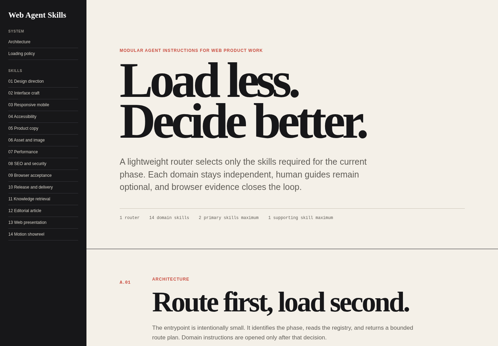

# Agent Skill Project

[English documentation](README.md)

[Buka website dokumentasi](https://revizahoshii-no.github.io/agent-skill-project/)

Sistem skill modular untuk pekerjaan produk web dengan pemuatan selektif. Router kecil mengenali fase aktif, membaca registry machine-readable, lalu memilih hanya instruksi domain yang dibutuhkan pada fase tersebut.



## Tujuan

Bundel instruksi besar menghabiskan konteks sebelum agent memahami tugas. Repository ini menggunakan model yang lebih terbatas:

- satu entrypoint routing yang ringan;
- empat belas skill domain mandiri;
- tidak ada pemuatan skill secara rekursif;
- tidak ada perintah untuk memuat seluruh kumpulan skill;
- panduan manusia dan screenshot tidak dimuat otomatis;
- maksimal dua primary skill dan satu supporting skill per fase;
- routing diulang saat fase pekerjaan berubah.

Hasilnya adalah rencana konteks yang terbatas, bukan prompt default yang besar.

## Mulai dari sini

Gunakan hanya file berikut sebagai entrypoint agent:

```text
skills/router/SKILL.md
```

Router boleh membaca:

```text
skills/registry.json
```

Router menghasilkan rencana seperti berikut:

```yaml
phase: implementation
primary:
  - skills/interface-craft/SKILL.md
  - skills/responsive-mobile/SKILL.md
supporting:
  - skills/accessibility/SKILL.md
reason: Membangun alur tugas, menentukan reflow layar sempit, dan memeriksa perilaku semantik.
```

Buka hanya path skill yang dikembalikan. Ketika pekerjaan berpindah dari perencanaan ke implementasi, acceptance, atau release, lakukan routing ulang dan jangan mempertahankan instruksi yang tidak lagi relevan.

## Instruksi agent yang disarankan

```text
Baca skills/router/SKILL.md terlebih dahulu. Kenali fase aktif, periksa skills/registry.json, lalu hasilkan rencana routing yang terbatas. Muat maksimal dua primary skill dan satu supporting skill. Jangan memuat file skill lain kecuali fase berubah dan router memilihnya.
```

## Arsitektur

```text
Permintaan
  -> skills/router/SKILL.md
  -> skills/registry.json
  -> file SKILL.md domain yang dipilih
  -> bukti dan handoff
  -> routing ulang saat fase berubah
```

Router tidak berisi workflow domain. Skill domain tidak boleh membuka skill domain lain. Panduan di `docs/guides/` hanya untuk manusia dan tidak pernah masuk ke konteks agent secara otomatis.

## Daftar skill

| Skill | Gunakan saat | Panduan manusia |
| --- | --- | --- |
| Design direction | Tesis visual atau komposisi belum jelas | [Panduan](docs/guides/design-direction.md) |
| Interface craft | Membangun form, navigasi, dashboard, kontrol, atau alur tugas | [Panduan](docs/guides/interface-craft.md) |
| Responsive mobile | Reflow, sentuhan, overflow, atau layar sempit perlu ditangani | [Panduan](docs/guides/responsive-mobile.md) |
| Accessibility | Memeriksa semantik, keyboard, fokus, error, kontras, atau motion | [Panduan](docs/guides/accessibility.md) |
| Product copy | Menulis bahasa halaman atau antarmuka berdasarkan fakta produk | [Panduan](docs/guides/product-copy.md) |
| Asset and image | Memilih, membuat, menyiapkan, atau menempatkan aset visual | [Panduan](docs/guides/asset-image.md) |
| Performance | Mengukur dan memperbaiki kecepatan atau stabilitas yang dirasakan user | [Panduan](docs/guides/performance.md) |
| SEO and security | Memeriksa discovery publik dan defensive posture | [Panduan](docs/guides/seo-security.md) |
| Browser acceptance | Membuktikan perilaku pada browser yang dirender | [Panduan](docs/guides/browser-acceptance.md) |
| Release and delivery | Menyiapkan commit, automasi, deployment, dan production smoke test | [Panduan](docs/guides/release-delivery.md) |
| Knowledge retrieval | Membaca materi lokal terstruktur secara progresif | [Panduan](docs/guides/knowledge-retrieval.md) |
| Editorial article | Membuat pengalaman baca panjang | [Panduan](docs/guides/editorial-article.md) |
| Web presentation | Membuat narasi web seperti slide | [Panduan](docs/guides/web-presentation.md) |
| Motion showreel | Merencanakan rangkaian visual pendek dan style frame | [Panduan](docs/guides/motion-showreel.md) |

Trigger, exclusion, fase, dan path machine-readable berada di [`skills/registry.json`](skills/registry.json).

## Contoh hasil render

Setiap panduan skill memiliki minimal dua screenshot dari halaman demo yang benar-benar dirender di browser. Gambar tersebut bukan mockup spekulatif. Source demo berada di [`docs/examples/`](docs/examples/) dan bukti tangkapan berada di [`docs/images/`](docs/images/).

Contohnya meliputi:

- landing page editorial pada viewport lebar dan sempit;
- workspace operasional dengan filter antrean yang berfungsi;
- form aksesibel pada state default dan error;
- artikel panjang pada viewport lebar dan sempit;
- catatan kualitas browser dan release;
- tampilan knowledge retrieval progresif;
- slide presentasi dengan state yang dapat dirutekan;
- pasangan style frame untuk motion.

## Struktur repository

```text
.
├── AGENTS.md
├── DESIGN.md
├── manifest.json
├── skills
│   ├── registry.json
│   ├── router/SKILL.md
│   └── <domain>/SKILL.md
├── docs
│   ├── index.html
│   ├── guides
│   ├── examples
│   └── images
├── scripts
│   └── validate.py
└── .github/workflows
    ├── validate.yml
    └── pages.yml
```

## Validasi

Jalankan:

```bash
python3 scripts/validate.py
```

Validator memeriksa integritas registry, batas pemuatan, bagian wajib skill, pola bulk-loading yang dilarang, link internal, referensi gambar, konten yang menyerupai credential, struktur HTML, dan cakupan dokumentasi.

Workflow continuous integration menjalankan validator yang sama pada push dan pull request. Workflow Pages melakukan deployment dokumentasi statis dari `docs/`.

## Prinsip desain dan konten

- Mulai dari tujuan produk, bukan pola dekoratif.
- Gunakan satu art direction yang koheren per artefak.
- Gunakan kontrol semantik dan pastikan interaksi benar-benar berfungsi.
- Perlakukan mobile sebagai komposisi yang dirancang dengan sengaja.
- Tulis copy yang spesifik dan jangan mengarang bukti.
- Ukur sebelum melakukan optimasi.
- Verifikasi di browser sebelum release.
- Jauhkan credential dan materi privat dari source dan output.

## Lisensi

[MIT](LICENSE)
