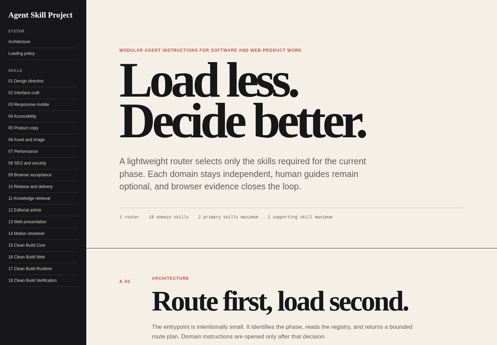

# Agent Skill Project

[Dokumentasi Bahasa Indonesia](README.id.md)

[Open the documentation website](https://revizahoshii-no.github.io/agent-skill-project/)

A modular software and web product skill system for selective loading. A small router identifies the current phase, reads a machine-readable registry, and selects only the domain instructions needed for that phase.



## Why it exists

Large instruction bundles consume context before the agent has understood the task. This repository uses a different model:

- one lightweight routing entrypoint;
- eighteen independent domain skills;
- no recursive skill loading;
- no command that loads the complete skill set;
- no automatic loading of human guides or screenshots;
- a maximum of two primary skills and one supporting skill per phase;
- rerouting when the phase changes.

The result is a bounded context plan rather than a large default prompt.

## Clean Build origin

The four Clean Build modules began as a personal working contract developed from repeated software projects with many coding agents. The rules were refined through practical research and testing, especially around scope drift, generic output, guessed technical facts, unsafe runtime actions, and completion claims made without direct verification.

The original long instruction was separated into Core, Web, Runtime, and Verification modules so the router can select the relevant quality contract without loading unrelated platform guidance.

## Start here

Use only this file as the agent entrypoint:

```text
skills/router/SKILL.md
```

The router may read:

```text
skills/registry.json
```

It returns a route plan similar to:

```yaml
phase: implementation
primary:
  - skills/interface-craft/SKILL.md
  - skills/responsive-mobile/SKILL.md
supporting:
  - skills/accessibility/SKILL.md
reason: Build the task flow, define narrow-screen reflow, and verify semantic behavior.
```

Open only the returned skill paths. When the work moves from planning to implementation, acceptance, or release, route again instead of retaining unrelated instructions.

## Suggested agent instruction

```text
Read skills/router/SKILL.md first. Classify the current phase, consult skills/registry.json, and return a bounded route plan. Load no more than two primary skills and one supporting skill. Do not load other skill files unless the phase changes and the router selects them.
```

## Architecture

```text
Request
  -> skills/router/SKILL.md
  -> skills/registry.json
  -> selected domain SKILL.md files
  -> evidence and handoff
  -> reroute on phase change
```

The router contains no domain workflow. Domain skills cannot open other domain skills. Human guides in `docs/guides/` are optional reading and never enter agent context automatically.

## Skills

| Skill | Route when | Human guide |
| --- | --- | --- |
| Design direction | The visual thesis or composition is unresolved | [Guide](docs/guides/design-direction.md) |
| Interface craft | Building forms, navigation, dashboards, controls, or task flows | [Guide](docs/guides/interface-craft.md) |
| Responsive mobile | Reflow, touch, overflow, or narrow-screen behavior matters | [Guide](docs/guides/responsive-mobile.md) |
| Accessibility | Reviewing semantics, keyboard behavior, focus, errors, contrast, or motion | [Guide](docs/guides/accessibility.md) |
| Product copy | Writing page or interface language from verified product truth | [Guide](docs/guides/product-copy.md) |
| Asset and image | Selecting, generating, preparing, or placing visual assets | [Guide](docs/guides/asset-image.md) |
| Performance | Measuring and improving user-visible speed or stability | [Guide](docs/guides/performance.md) |
| SEO and security | Reviewing public discovery and defensive posture | [Guide](docs/guides/seo-security.md) |
| Browser acceptance | Proving behavior in a rendered browser | [Guide](docs/guides/browser-acceptance.md) |
| Release and delivery | Preparing commits, automation, deployment, and production smoke checks | [Guide](docs/guides/release-delivery.md) |
| Knowledge retrieval | Reading structured local material progressively | [Guide](docs/guides/knowledge-retrieval.md) |
| Editorial article | Building a long-form reading experience | [Guide](docs/guides/editorial-article.md) |
| Web presentation | Building a slide-like web narrative | [Guide](docs/guides/web-presentation.md) |
| Motion showreel | Planning short visual sequences and style frames | [Guide](docs/guides/motion-showreel.md) |
| Clean Build Core | Controlling scope, truth, code hygiene, context, and completion claims | [Guide](docs/guides/clean-build-core.md) |
| Clean Build Web | Removing generic web output, fabricated content, dead controls, and template structure | [Guide](docs/guides/clean-build-web.md) |
| Clean Build Runtime | Building APIs, backends, bots, scripts, and CLI tools safely | [Guide](docs/guides/clean-build-runtime.md) |
| Clean Build Verification | Proving software behavior across browser and non-browser surfaces | [Guide](docs/guides/clean-build-verification.md) |

Machine-readable triggers, exclusions, phases, and paths live in [`skills/registry.json`](skills/registry.json).

## Rendered examples

Every human skill guide includes at least two screenshots from browser-rendered demo pages. These are not speculative mockups. The source pages live in [`docs/examples/`](docs/examples/) and the captured evidence lives in [`docs/images/`](docs/images/).

Examples include:

- editorial landing page at wide and narrow viewports;
- operational workspace with a working queue filter;
- accessible form in default and error states;
- long-form article at wide and narrow viewports;
- browser quality and release records;
- progressive knowledge retrieval view;
- routeable presentation slides;
- paired motion style frames.

## Repository structure

```text
.
├── AGENTS.md
├── DESIGN.md
├── manifest.json
├── skills
│   ├── registry.json
│   ├── router/SKILL.md
│   └── <domain>/SKILL.md
├── docs
│   ├── index.html
│   ├── guides
│   ├── examples
│   └── images
├── scripts
│   └── validate.py
└── .github/workflows
    ├── validate.yml
    └── pages.yml
```

## Validation

Run:

```bash
python3 scripts/validate.py
```

Validation checks registry integrity, load limits, required skill sections, forbidden bulk-loading patterns, internal links, image references, credential-like content, HTML structure, and documentation coverage.

The continuous integration workflow runs the same validator on pushes and pull requests. The Pages workflow deploys the static documentation from `docs/`.

## Design and content principles

- Start from product purpose, not decorative patterns.
- Keep one coherent art direction per artifact.
- Use semantic controls and make interactions real.
- Treat mobile as a deliberate composition.
- Write specific copy and never invent evidence.
- Measure before optimizing.
- Verify in a browser before release.
- Keep credentials and private material out of source and output.

## License

[MIT](LICENSE)
