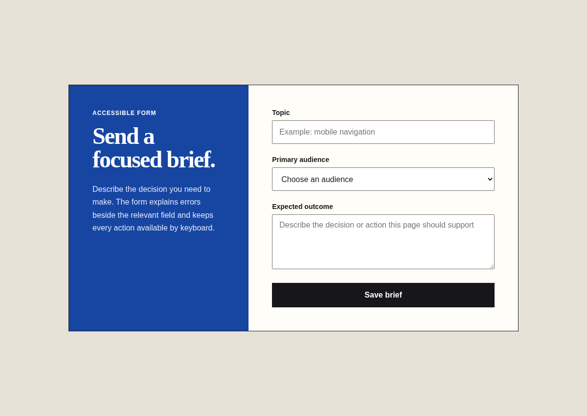
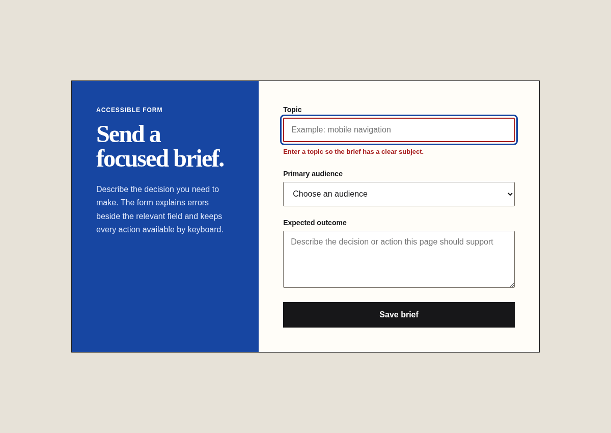

# Accessibility

Agent instruction: [`skills/accessibility/SKILL.md`](../../skills/accessibility/SKILL.md)

## Purpose

Integrate semantics, keyboard operation, focus, names, instructions, error recovery, contrast, zoom, and motion preferences.

## Route here when

Use while building or auditing interactive controls, forms, navigation, dynamic updates, media, and custom widgets.

## Do not route here when

Do not treat an automated scan as a complete accessibility review.

## What this skill owns

Keyboard paths, focus management, accessible names, landmarks, heading order, labels, error associations, announcements, contrast, zoom, and reduced motion.

## Procedure

1. Identify the user path and exercise it with keyboard only.
2. Inspect semantic structure, names, descriptions, labels, and dynamic announcements.
3. Trigger errors and state changes, then verify focus and recovery.
4. Check contrast, zoom, narrow reflow, target size, and motion preferences.
5. Rank findings by user impact and verify each fix in the rendered interface.

## Evidence of completion

Reproducible paths, user impact, affected control, expected behavior, actual behavior, and confirmation after the fix.

## Pairing

Pair with interface-craft during implementation; browser-acceptance for end-to-end proof.

## Rendered examples

These images are screenshots from the browser-rendered demo pages in this repository.

Visible labels and native controls provide a predictable base.

The field receives focus and a specific adjacent message when validation fails.

## Human documentation boundary

This guide and its images are for people. The router does not load them automatically. Agent context uses only the selected `SKILL.md` files for the current phase.
