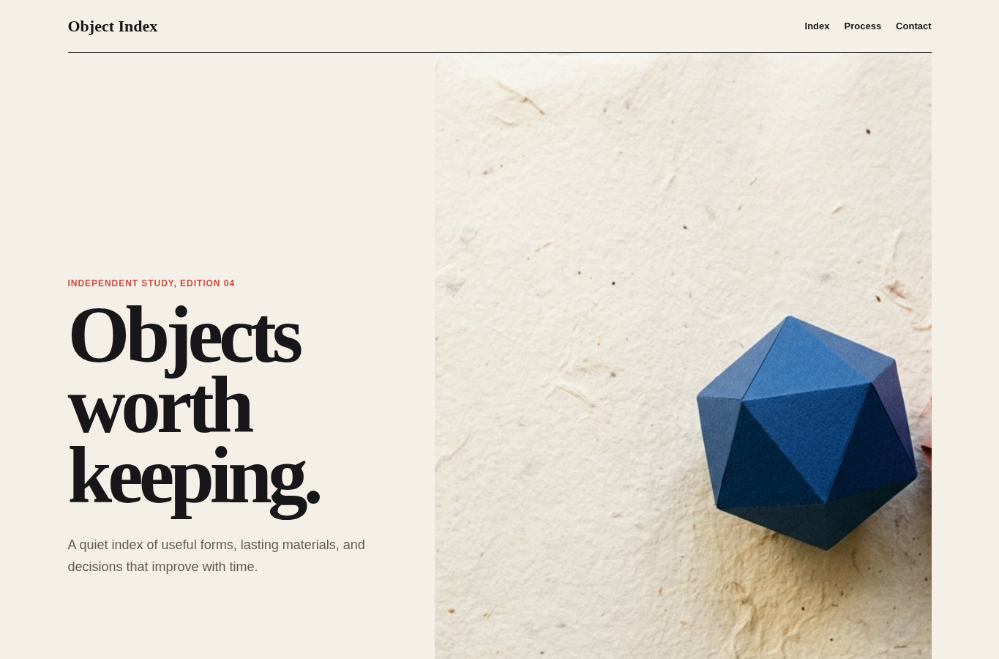
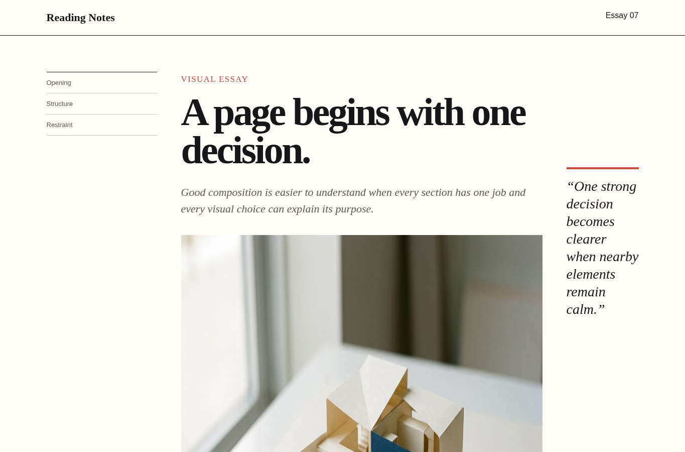

# Asset and image

Agent instruction: [`skills/asset-image/SKILL.md`](../../skills/asset-image/SKILL.md)

## Purpose

Select, create, prepare, and place images according to a defined editorial or product role.

## Route here when

Use when a page depends on photography, illustration, diagrams, generated visuals, icons, or media optimization.

## Do not route here when

Do not add imagery only to fill empty space or copy assets without a clear right to use them.

## What this skill owns

Asset brief, source and rights record, crop, format, dimensions, loading priority, alt text, caption, and placement behavior.

## Procedure

1. State what the image must explain, establish, or make memorable.
2. Search existing assets before generating or sourcing new material.
3. Record provenance and usage constraints for every selected file.
4. Prepare dimensions, crop, format, compression, alt text, and loading priority.
5. Inspect the image in the final layout at narrow and wide viewports.

## Evidence of completion

An asset manifest with purpose, source, rights, dimensions, alt text, placement, loading behavior, and rendered screenshots.

## Pairing

Pair with design-direction for visual role; performance for media cost and loading.

## Rendered examples

These images are screenshots from the browser-rendered demo pages in this repository.

The generated still life is structural to the page rather than decorative filler.

The paper model supports the argument and receives a precise caption.

## Human documentation boundary

This guide and its images are for people. The router does not load them automatically. Agent context uses only the selected `SKILL.md` files for the current phase.
