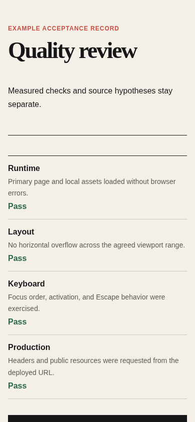

# Browser acceptance

Agent instruction: [`skills/browser-acceptance/SKILL.md`](../../skills/browser-acceptance/SKILL.md)

## Purpose

Exercise real user paths in the rendered interface and capture evidence across viewports, states, keyboard, console, and network.

## Route here when

Use after implementation, during bug reproduction, before release, or when source inspection cannot prove behavior.

## Do not route here when

Do not use screenshots alone as proof that an interaction or keyboard path works.

## What this skill owns

Acceptance scenarios, viewport coverage, interactions, keyboard paths, screenshots, console errors, failed requests, and observed results.

## Procedure

1. Write scenarios with starting state, action, expected result, and required viewport.
2. Load the real page and record console errors, failed requests, and broken resources.
3. Exercise the primary path with pointer and keyboard, including error and recovery states.
4. Inspect narrow and wide layouts for overflow, clipping, hidden actions, and unstable movement.
5. For blocking overlays, record scroll position, open the overlay, attempt background movement, close it, and compare the restored position.
6. Verify direction-aware reveals while scrolling down and back up, including reduced-motion emulation.
7. Inspect computed selection behavior on shielded interface chrome and explicit copyable content.
8. Capture evidence and classify failures by severity, scope, and reproducibility.

## Interaction-motion acceptance

For a direction-aware reveal, verify:

- downward entry records `down` and begins from a positive vertical offset;
- upward entry records `up` and begins from a negative vertical offset;
- an element does not flicker at the observer boundary;
- native wheel and touch scrolling remain available;
- reduced motion leaves no long-running reveal animation.

For accidental-selection shielding, verify:

- shielded controls compute to `user-select: none`;
- explicit copyable content computes to `user-select: text`;
- input, textarea, contenteditable, copy, and paste are not blocked;
- no global copy or context-menu event blocker was introduced.

For a blocking overlay, verify:

- body lock records the current page position;
- wheel and touch cannot move the background;
- the overlay itself can scroll when necessary;
- background content is inert;
- Tab and Shift+Tab remain inside;
- Escape closes when allowed;
- closing restores the recorded scroll position and opening trigger focus;
- repeated open and close cycles leave no inline lock styles behind.

## Evidence of completion

A scenario table with expected and actual results, viewport, screenshot path, console and network notes, scroll restoration delta, reduced-motion result, and a pass or fail decision.

## Pairing

Pair with accessibility for assistive behavior; release-delivery for final production smoke tests.

## Rendered examples

These images are screenshots from the browser-rendered demo pages in this repository.

The record ties each pass to a concrete browser check.

The same evidence remains complete at a narrow viewport.

## Human documentation boundary

This guide and its images are for people. The router does not load them automatically. Agent context uses only the selected `SKILL.md` files for the current phase.
