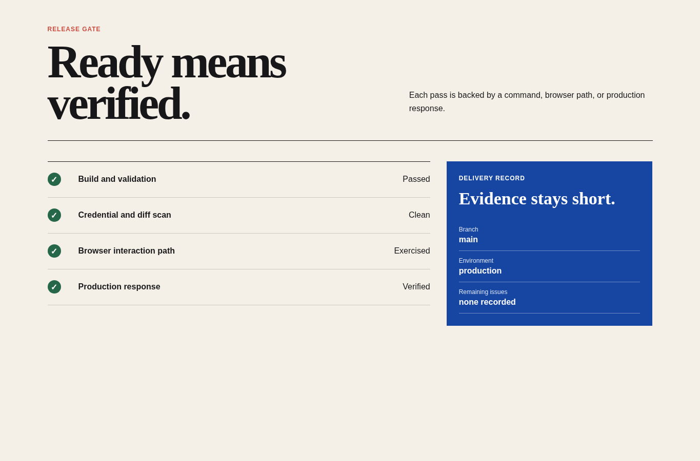

# Clean Build Core

Agent instruction: [`skills/clean-build-core/SKILL.md`](../../skills/clean-build-core/SKILL.md)

## Origin

Clean Build began as a personal working contract distilled from repeated software projects with many coding agents. Its rules were refined through practical research, failed handoffs, verification work, and the recurring difference between code that merely looks complete and work that has actually been exercised.

## Purpose

Keep software work scoped, truthful, maintainable, and evidence-based without loading platform-specific rules that the current task does not need.

## Route here when

Use this module when scope drift, fabricated facts, noisy generated code, weak context continuity, or an unverified completion claim is a material risk.

## Do not route here when

Do not add it as ceremony when a narrower domain skill already provides the required quality gate.

## What this skill owns

Scope discipline, risk questions, no-comment defaults, evidence honesty, compact context continuity, completion criteria, and final reporting.

## Procedure

1. Read the project and identify the smallest coherent outcome.
2. Ask only when ambiguity or risk would materially change the work.
3. Verify technical facts before depending on them.
4. Implement without speculative extras or generated-code residue.
5. Execute checks that match the changed behavior.
6. Separate observed evidence, assumptions, unknowns, and optional recommendations.

## Evidence of completion

A valid report names the result, exact run command, checks executed, observed outcomes, and anything that remains unverified.

## Pairing

Pair with one domain skill whose implementation or review rules match the current phase. Do not combine every Clean Build module.

## Rendered examples

These images are screenshots from browser-rendered demo pages in this repository.

A compact release gate shows how claims remain attached to executable evidence.

The quality record states what was measured and avoids turning a limited check into a broad guarantee.

## Human documentation boundary

This guide and its images are for people. The router does not load them automatically. Agent context uses only the selected `SKILL.md` files for the current phase.
