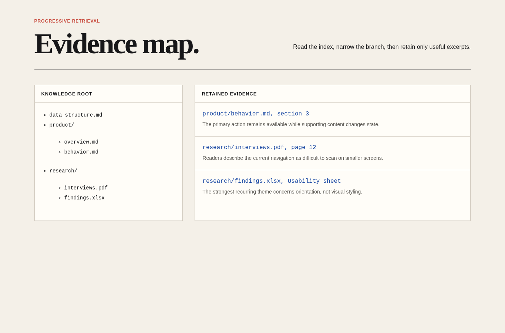
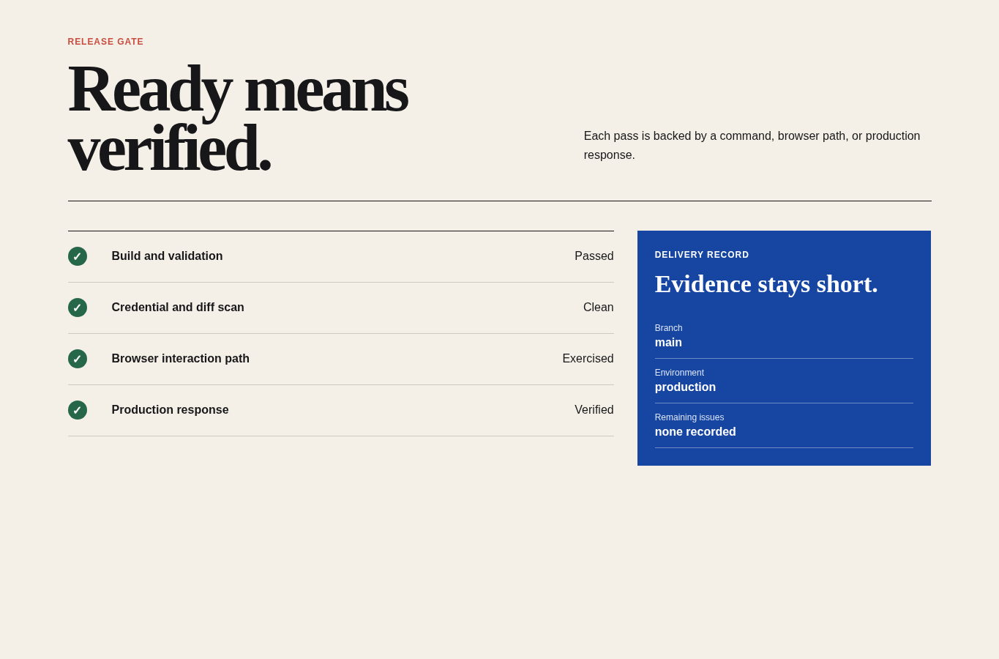

# Clean Build Runtime

Agent instruction: [`skills/clean-build-runtime/SKILL.md`](../../skills/clean-build-runtime/SKILL.md)

## Purpose

Build and repair APIs, backends, bots, scripts, and command-line tools without guessed library calls, unsafe live actions, hidden failures, careless dependencies, or exposed secrets.

## Route here when

Use this module when work touches a non-browser runtime, external service, messaging platform, user-controlled input, destructive action, native dependency, or runtime defect.

## Do not route here when

Do not use it for a browser-only visual change or a planning task with no runtime implementation.

## What this skill owns

Runtime contract verification, dependency safety, bot and messaging guards, API boundaries, secrets, causal defect repair, and failure integrity.

## Procedure

1. Confirm runtime, package manager, commands, environment, permissions, and side effects.
2. Verify uncertain library behavior from installed source or current authoritative documentation.
3. Keep dependencies minimal, pinned, and compatible with the target environment.
4. Guard destructive actions, permissions, identifiers, retries, and duplicate effects.
5. Reproduce defects before repair and repeat the original path after the change.
6. Test failure behavior without exposing secrets or using live recipients without permission.

## Evidence of completion

Record runtime and version, contract inspected, inputs and side effects exercised, permission guards, success and failure paths, clean build or installation, and environmental limits.

## Pairing

Pair with Clean Build Core for scope and reporting, or Clean Build Verification when the task enters acceptance.

## Rendered examples

These images are screenshots from browser-rendered demo pages in this repository.

The evidence map demonstrates a runtime principle: verify the exact contract and retain its source location instead of relying on memory.

The release view keeps secret scanning, executable behavior, and production responses inside the delivery gate.

## Human documentation boundary

This guide and its images are for people. The router does not load them automatically. Agent context uses only the selected `SKILL.md` files for the current phase.
