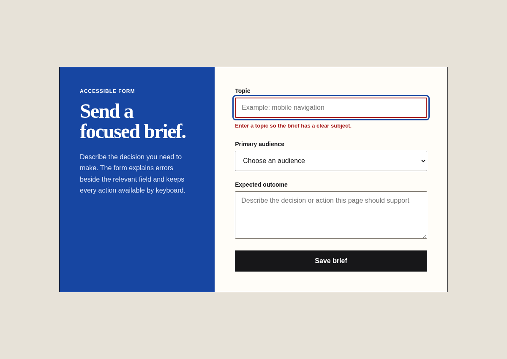

# Clean Build Verification

Agent instruction: [`skills/clean-build-verification/SKILL.md`](../../skills/clean-build-verification/SKILL.md)

## Purpose

Prove software behavior through proportionate executable checks before making a completion claim.

## Route here when

Use this module for cross-platform acceptance, bug reproduction, API and backend verification, mocked bot behavior, script and CLI checks, or a project with no clear test plan.

## Do not route here when

Do not use it for planning without implementation. Prefer the browser-specific skill when the entire acceptance scope is a rendered website.

## What this skill owns

Verification contracts, clean-state execution, success and failure paths, platform-specific matrices, evidence collection, and honest pass criteria.

## Procedure

1. Name the changed behavior, protected behavior, environment, and evidence required for a pass.
2. Run project-wide syntax, build, lint, type, or test checks that apply.
3. Reproduce the target behavior through its real entrypoint.
4. Exercise a normal path, a failure path, and relevant boundary input.
5. Inspect output, side effects, logs, state, screenshots, or exit codes.
6. Remove temporary instrumentation and report exact commands and limits.

## Evidence of completion

A valid report lists the environment, commands, paths and inputs, observed passes, repaired failures, inspected artifacts, and anything not verified.

## Pairing

Pair with Clean Build Runtime for APIs, bots, scripts, and command-line tools. Pair with Browser Acceptance only when a release crosses both browser and non-browser surfaces.

## Rendered examples

These images are screenshots from browser-rendered demo pages in this repository.

The error state proves a real failure path, associated feedback, and visible focus rather than a default-state screenshot alone.

The acceptance record separates runtime, layout, keyboard, and production evidence into independently verifiable conditions.

## Human documentation boundary

This guide and its images are for people. The router does not load them automatically. Agent context uses only the selected `SKILL.md` files for the current phase.
