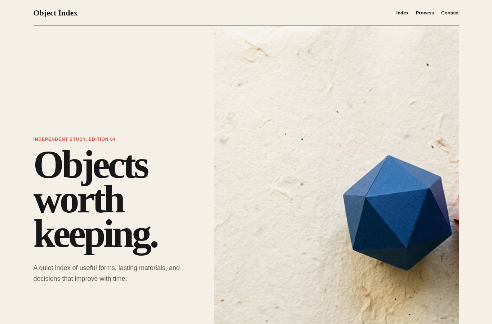
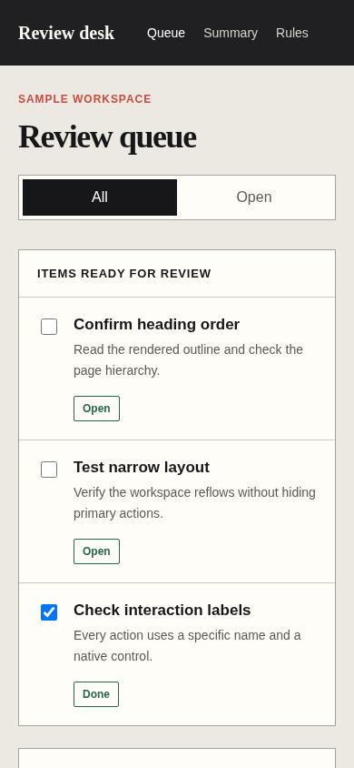

# Clean Build Web

Agent instruction: [`skills/clean-build-web/SKILL.md`](../../skills/clean-build-web/SKILL.md)

## Purpose

Prevent generic, fabricated, inaccessible, or mechanically templated browser output while keeping content, composition, mobile behavior, and interaction specific to the product.

## Route here when

Use this module when a website or interface looks machine-generated, contains unsupported proof, includes decorative filler, or has controls and responsive states that were never completed.

## Do not route here when

Do not use it for a backend-only change or as a replacement for browser acceptance after implementation.

## What this skill owns

Content truth, specificity, anti-template composition, real interactions, narrow-screen behavior, accessibility basics, media posture, and web completion evidence.

## Procedure

1. Read the approved visual direction or identify the missing decision.
2. Separate verified content from unknown product facts.
3. Give each section one job and remove template-driven filler.
4. Implement semantic controls and the states the task actually needs.
5. Compose mobile from reading order and action priority.
6. Exercise the rendered interface and inspect screenshots before reporting quality.

## Evidence of completion

Record the direction used, honest placeholders, routes and controls exercised, narrow and wide viewports, keyboard behavior, runtime errors, screenshots, and remaining limits.

## Pairing

Pair with interface craft for implementation, product copy for a substantial messaging task, or responsive mobile when reflow is the primary risk.

## Rendered examples

These images are screenshots from browser-rendered demo pages in this repository.

A specific premise controls the headline, image, hierarchy, and section structure instead of a generic landing-page formula.

The mobile workspace preserves task order, labels, controls, and readable states without horizontal overflow.

## Human documentation boundary

This guide and its images are for people. The router does not load them automatically. Agent context uses only the selected `SKILL.md` files for the current phase.
