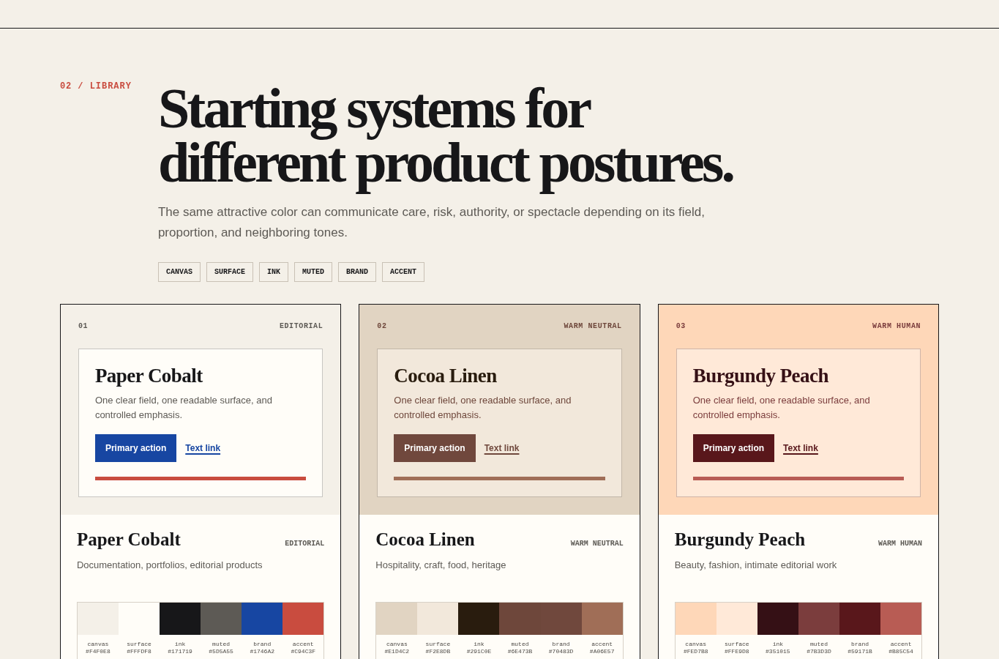
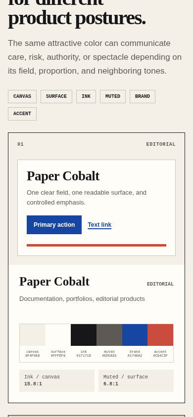
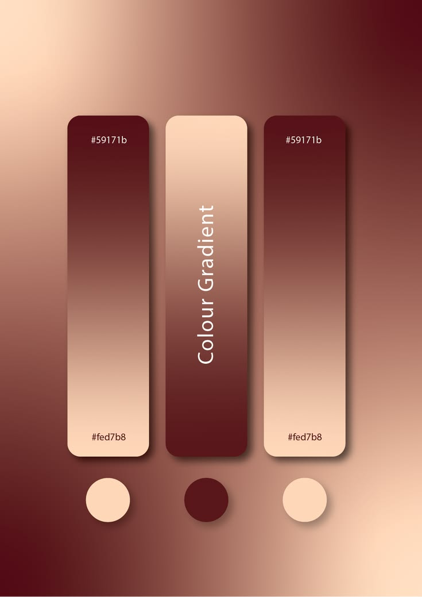
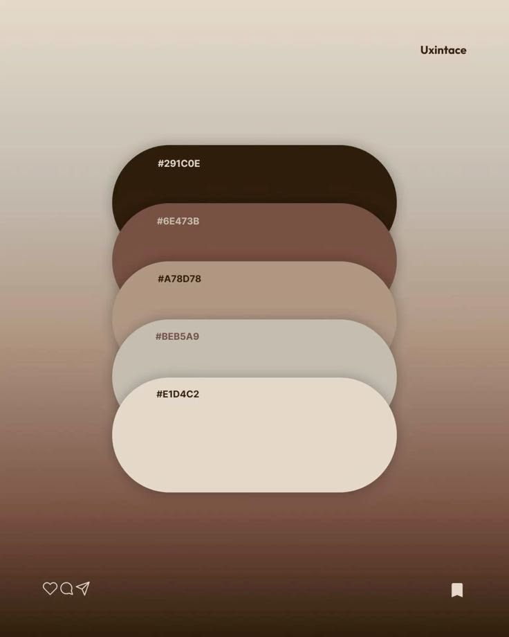
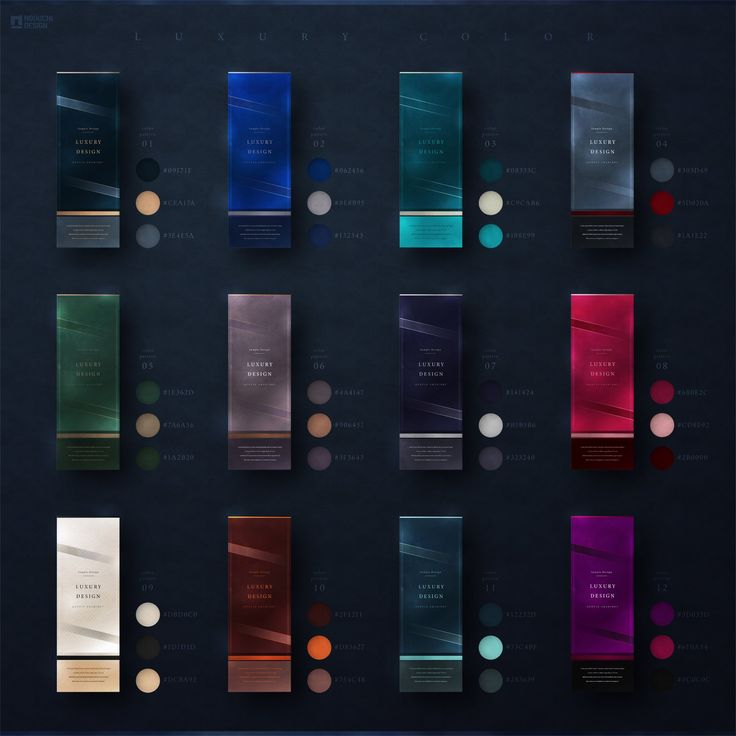
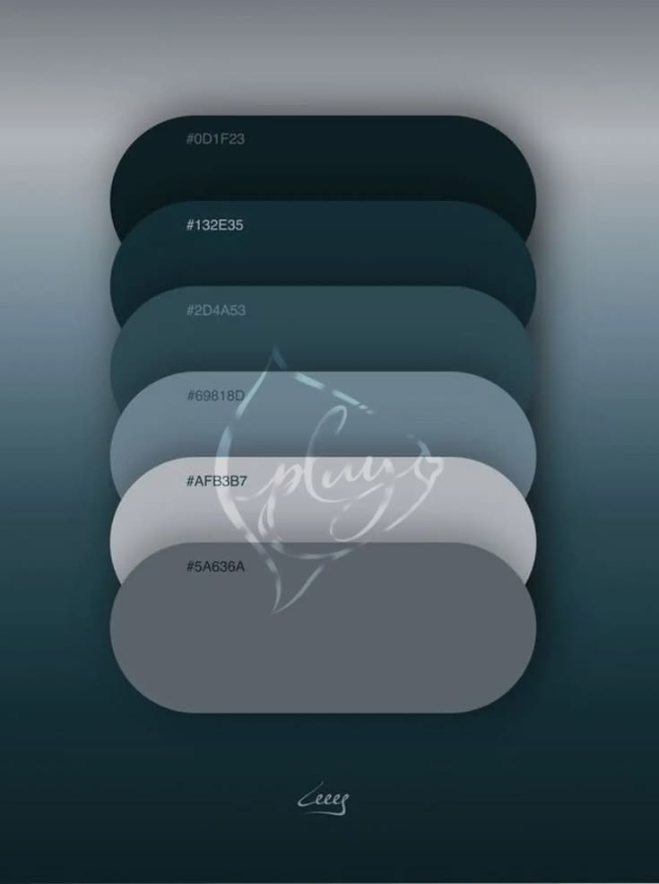
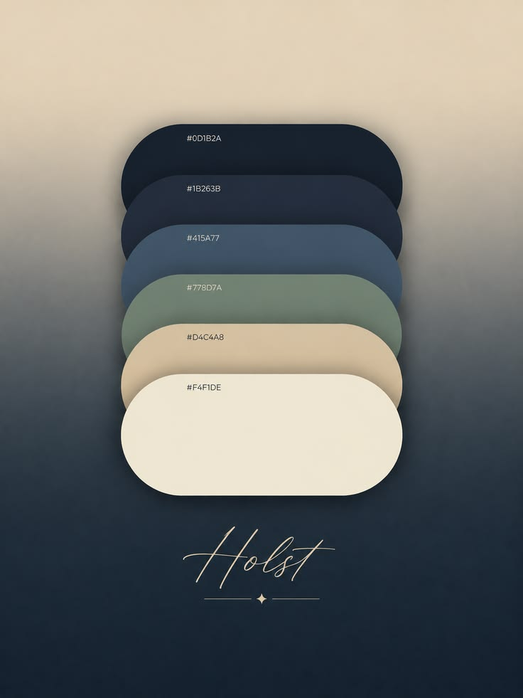

# Color systems

Agent instruction: [`skills/color-systems/SKILL.md`](../../skills/color-systems/SKILL.md)

## Purpose

Turn visual references and product requirements into semantic, accessible, implementation-ready color roles instead of disconnected swatches.

## Route here when

Use for palette selection, theme creation, color-token definition, dark-mode pairing, reference extraction, contrast repair, or deciding which combinations fit a product category.

## Do not route here when

Do not use it for photo color grading, print calibration, or a single color replacement whose token and behavior are already fixed.

## What this skill owns

Color posture, semantic roles, palette relationships, light and dark theme logic, component pair verification, focus visibility, and state-color separation.

## Procedure

1. Identify the product posture, audience, density, image dependence, and required brand constraints.
2. Read a reference as relationships: field, support, anchor, relief, and signal.
3. Map those relationships to canvas, surface, ink, muted ink, border, brand, accent, focus, and semantic states.
4. Start from one coherent family and control the proportion of saturated color.
5. Verify actual foreground and background pairs in rendered components.
6. Rebuild dark mode as a separate surface system rather than inverting the light palette.
7. Record rejected alternatives so later work does not reintroduce conflicting accents.

## Included palette library

The agent skill contains 24 starting systems across editorial, warm human, technical, cinematic, playful, commerce, health, data, and operational use cases. Each system supplies canvas, surface, ink, muted, brand, and accent values plus a recommended product fit.

The browser-rendered reference page shows every system as tokens, contrast readings, and a compact component preview:

- [Open the complete color-system example](../examples/color-systems.html)

## Evidence of completion

A semantic token map, measured contrast pairs, complete interaction states, a light and dark pairing when required, and screenshots showing the palette inside realistic UI rather than only as circles or strips.

## Pairing

Pair through the router with design planning when the visual thesis is unresolved, interface implementation when components must be changed, or accessibility review when contrast and non-color cues need independent verification.

## Rendered examples

The desktop reference compares multiple palette families without allowing any single accent to dominate the whole documentation page.

The mobile view keeps token values, contrast readings, and intended use readable without horizontal overflow.

## Supplied reference board

These user-supplied references informed the relationship patterns and canonical palettes. They are retained as visual evidence for humans; the router does not preload them into agent context.

Burgundy Peach demonstrates a warm field, deep red anchor, and soft peach relief suitable for intimate editorial, beauty, and fashion contexts.

Cocoa Linen shows how a quiet neutral family can preserve depth through lightness instead of relying on multiple accents.

The matrix demonstrates that a shared luxury posture can survive across different hue families when depth, restraint, and material contrast remain consistent.

Deep Teal Fog provides a dark technical and cinematic structure with cool relief colors for text and controls.

Navy Sage balances an authoritative cool anchor with botanical support and a quiet warm surface.

## Human documentation boundary

This guide and its images are for people. Agent context uses the selected `SKILL.md` only; images and demo pages stay optional so routing remains bounded.
