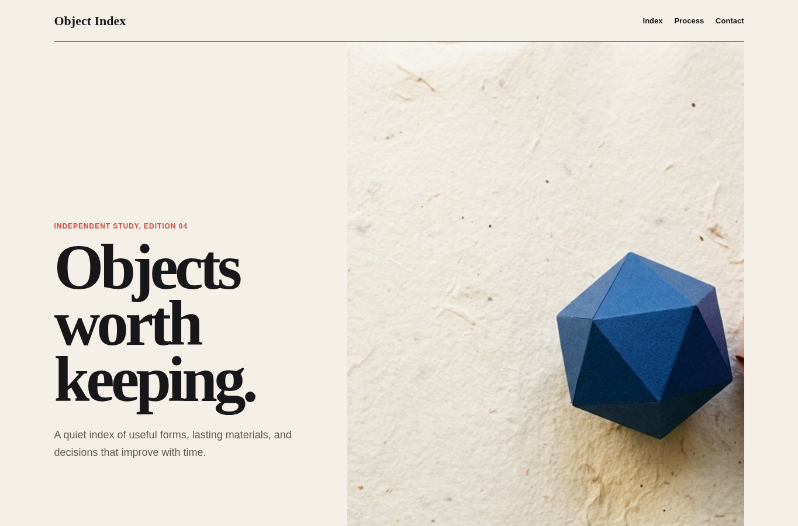
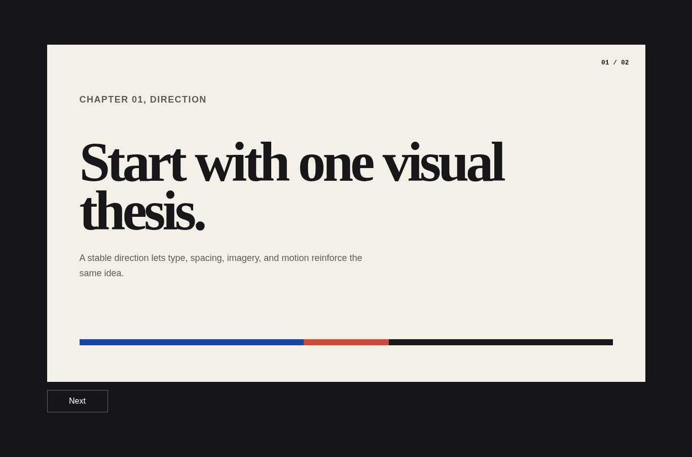

# Design direction

Agent instruction: [`skills/design-direction/SKILL.md`](../../skills/design-direction/SKILL.md)

## Purpose

Convert requirements and references into one testable visual thesis before implementation starts.

## Route here when

Use for greenfield pages, redesigns without a settled visual system, or interfaces where multiple references compete.

## Do not route here when

Do not use it as a substitute for product requirements or to redesign an interface whose direction is already fixed.

## What this skill owns

Page archetype, composition, type roles, palette, spacing rhythm, density, imagery posture, and motion posture.

## Procedure

1. Collect the product goal, audience, content constraints, and available assets.
2. Write the intended feeling and the single visual idea that should create it.
3. Set explicit dials for energy, density, rhythm, motion, asset dependence, variance, and fidelity.
4. Describe hierarchy, type roles, color behavior, image role, and one signature motif.
5. Record decisions in DESIGN.md and define what browser evidence would contradict them.

## Evidence of completion

A concise design read, explicit dials, a stable palette and type role map, and review notes tied to rendered pages.

## Pairing

Pair with interface-craft for implementation; product-copy when the message hierarchy is unresolved.

## Rendered examples

These images are screenshots from the browser-rendered demo pages in this repository.

A visual thesis expressed through scale, paper texture, restraint, and asymmetry.

The same direction carried into a stable presentation stage.

## Human documentation boundary

This guide and its images are for people. The router does not load them automatically. Agent context uses only the selected `SKILL.md` files for the current phase.
