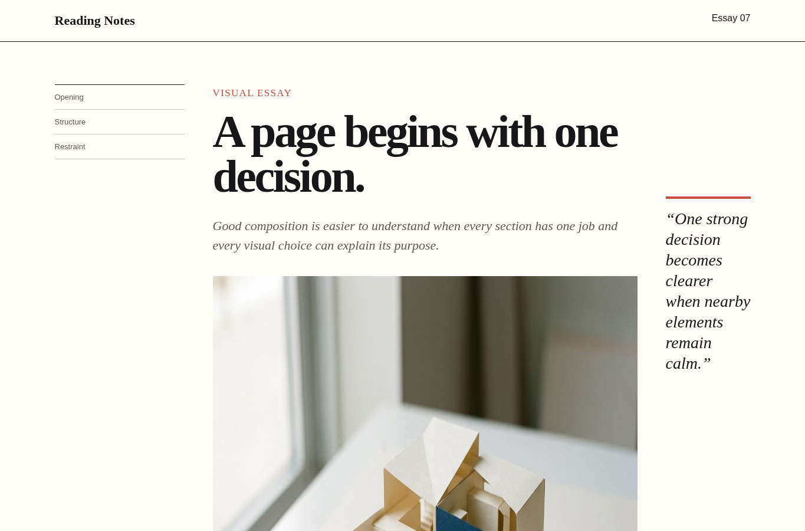
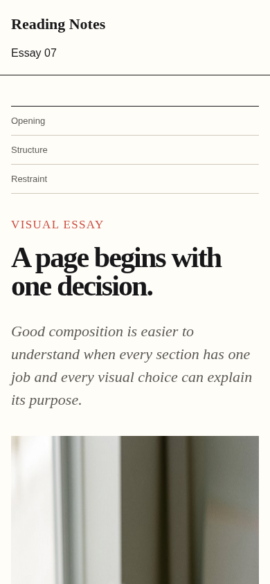

# Editorial article

Agent instruction: [`skills/editorial-article/SKILL.md`](../../skills/editorial-article/SKILL.md)

## Purpose

Shape long-form content into a coherent reading experience with argument, pace, hierarchy, figures, captions, references, and responsive type.

## Route here when

Use for essays, explainers, research narratives, documentation chapters, or visual stories.

## Do not route here when

Do not use it for slide decks, short interface copy, or a page whose primary purpose is task completion.

## What this skill owns

Article structure, introduction, section sequence, reading measure, heading rhythm, figures, captions, references, and narrow-screen order.

## Procedure

1. Define the reader, central claim, evidence, and intended change in understanding.
2. Build an outline where each section advances the argument.
3. Assign roles to figures, captions, quotations, notes, and references.
4. Compose a readable measure and hierarchy at wide and narrow viewports.
5. Read the rendered article for continuity, repetition, unsupported claims, and broken anchors.

## Evidence of completion

A complete outline, source-aware draft, figure plan, caption set, working anchors, and responsive screenshots.

## Pairing

Pair with knowledge-retrieval for evidence; asset-image for figures and captions.

## Rendered examples

These images are screenshots from the browser-rendered demo pages in this repository.

Contents, reading column, figure, and margin note form one system.

The wide composition becomes a clear single-column reading path.

## Human documentation boundary

This guide and its images are for people. The router does not load them automatically. Agent context uses only the selected `SKILL.md` files for the current phase.
