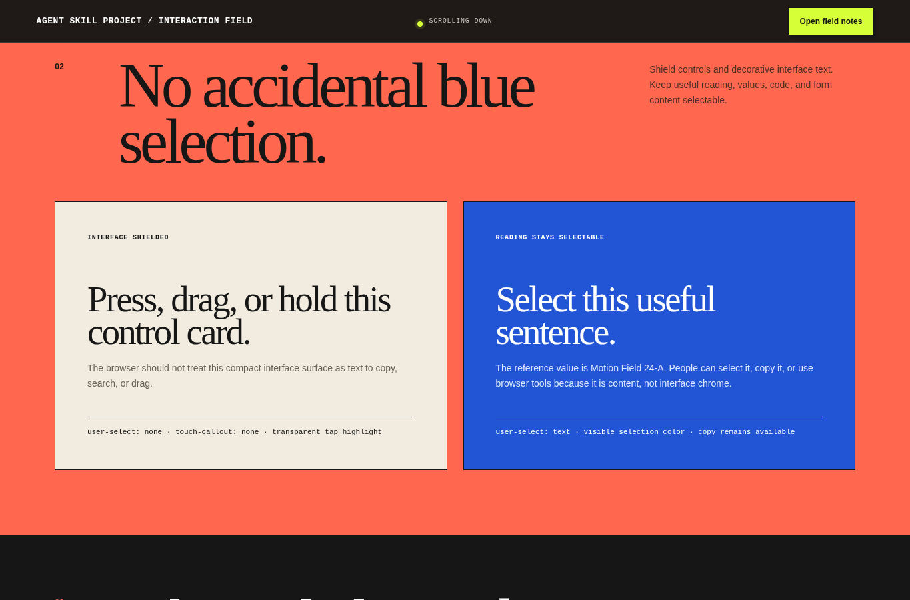
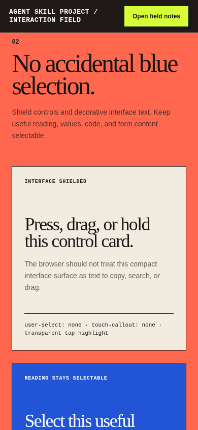
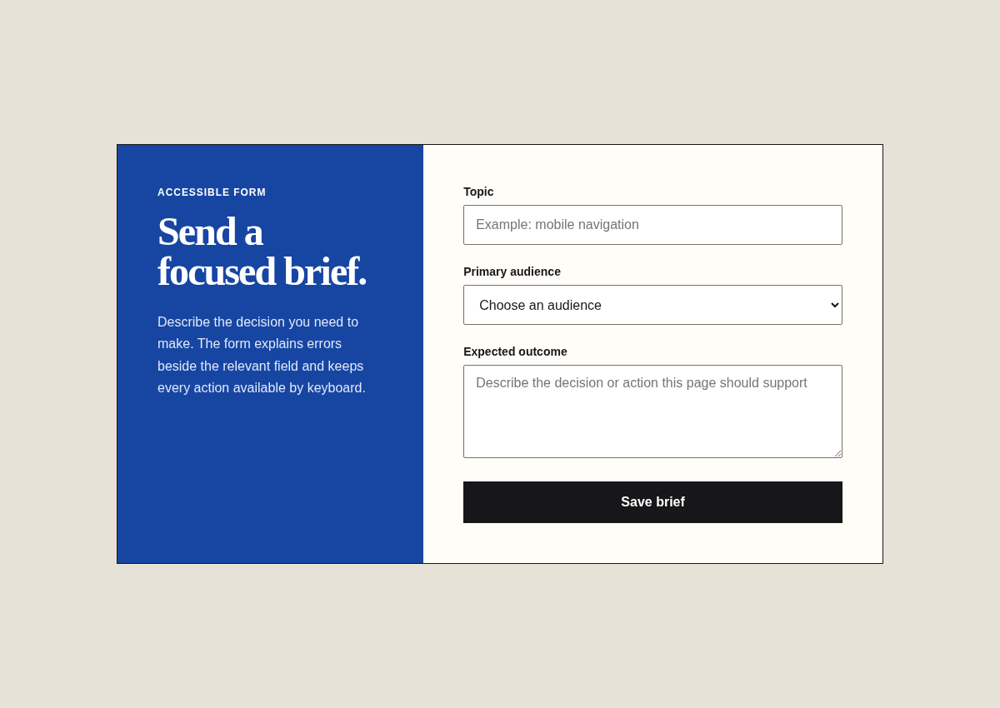

# Interface craft

Agent instruction: [`skills/interface-craft/SKILL.md`](../../skills/interface-craft/SKILL.md)

## Purpose

Build task-focused interfaces with semantic controls, explicit state, coherent feedback, deliberate motion, and complete overlay behavior.

## Route here when

Use for forms, navigation, dashboards, filters, dialogs, drawers, settings, empty states, state transitions, scroll reveal, accidental-selection shielding, and task flows.

## Do not route here when

Do not use for visual direction alone, content security claims, inertial scrolling without explicit approval, or browser acceptance after implementation is complete.

## What this skill owns

- component behavior and information hierarchy;
- semantic controls and complete states;
- interaction motion and transition continuity;
- blocking-overlay focus and scroll behavior;
- selective shielding from accidental mobile text selection and touch callouts;
- implementation simplicity and reduced-motion behavior.

## Decision template

```text
Primary user task:
Success condition:
Controls and state changes:
Blocking overlays:
Scroll position that must be preserved:
Useful text that must stay selectable:
Interface chrome that should resist long press:
Motion purpose:
Scroll-reveal behavior:
Reduced-motion state:
Target viewport and touch environment:
```

## Procedure

1. Name the task and success condition before choosing components.
2. Map default, hover, focus, active, loading, empty, error, success, and disabled states that apply.
3. Choose native elements first and define keyboard behavior for custom interactions.
4. Build the smallest coherent flow and keep the primary action visible at the right moment.
5. Add overlay scroll and focus behavior before visual polish.
6. Shield only interface chrome from accidental selection.
7. Add purposeful motion after final states already work.
8. Verify pointer, keyboard, touch, narrow-screen, reduced-motion, and interruption paths.

## Motion choreography

The interaction field uses the same movement principles that make the Preset Finder feel smooth without adding an animation library.

### Token set

```css
:root {
  --ease-premium: cubic-bezier(.16, 1, .3, 1);
  --motion-fast: 180ms;
  --motion-state: 380ms;
  --motion-reveal: 700ms;
}
```

The custom easing starts decisively and settles slowly. It works well for drawers, section reveal, object continuity, and state changes. It should not be applied to every property or every control.

### Direction-aware reveal

[Open the browser-rendered interaction field](../examples/interaction-motion.html)





The demo keeps native wheel and touch scrolling. A passive scroll listener records only the direction, while `IntersectionObserver` decides when an element enters or fully exits.

- Scrolling down: the element enters from 48 pixels below.
- Scrolling up: the element enters from 48 pixels above.
- Both paths use opacity, translation, and a small scale settle.
- Related children may stagger by 40 to 90 milliseconds.
- An element resets only after fully leaving in the direction of travel.
- Reduced motion shows the final state immediately.

Do not continuously animate while scroll position changes. Do not map every scroll pixel to transforms unless the product explicitly requires a scrubbed experience.

### Shared continuity

FLIP-style motion is appropriate when one object changes position or size between two states. Measure its first and last geometry, invert the delta, then animate to the final layout.

Use it for:

- a selected media tile becoming a detail preview;
- a thumbnail becoming a lightbox image;
- a compact player becoming an expanded player;
- a search result moving into a saved collection.

Do not use shared-element motion between unrelated content just because the transition looks impressive.

## Selective accidental-selection shielding

The blue glow, blue text range, or browser menu that appears after an accidental hold is usually a combination of:

- text selection highlight;
- mobile long-press selection;
- WebKit touch callout;
- tap highlight;
- image drag behavior.

This is an interaction issue, not content security.

### Shield these surfaces

- buttons, tabs, icon labels, compact navigation, and drag handles;
- decorative badges and control cards;
- decorative images that are not intended to be dragged or saved;
- short labels where long press exposes a copy or search menu instead of a useful action.

### Keep these selectable

- articles, descriptions, addresses, IDs, reference values, and generated output;
- code, logs, configuration, and explicit copy targets;
- input, textarea, and contenteditable regions;
- content whose selection is useful to the task or assistive workflow.

### Scoped implementation

```css
[data-ui-shield] {
  -webkit-user-select: none;
  user-select: none;
  -webkit-touch-callout: none;
  -webkit-tap-highlight-color: transparent;
}

[data-copyable],
input,
textarea,
[contenteditable="true"] {
  -webkit-user-select: text;
  user-select: text;
  -webkit-touch-callout: default;
}
```

Do not add global handlers that block `copy`, `contextmenu`, keyboard shortcuts, or paste. Those handlers are easy to bypass and damage usability.

The browser example places a shielded control card beside a deliberately selectable reference card. The contrast makes the policy visible and testable.

## Blocking overlay and drawer contract

A modal dialog, blocking drawer, or lightbox should prevent background movement. A tooltip, toast, popover, or non-modal inspector usually should not.

When a blocking overlay opens:

1. record `scrollY`;
2. measure scrollbar width;
3. fix the body at the recorded offset;
4. compensate for scrollbar removal;
5. mark background content inert;
6. focus the first meaningful control in the overlay;
7. contain Tab and Shift+Tab;
8. contain touch overscroll inside the overlay body.

When it closes:

1. remove temporary positioning and padding;
2. restore the exact stored page position;
3. remove inert state;
4. update `aria-expanded` and hidden state;
5. return focus to the trigger that opened it.

The browser example provides two triggers. Focus returns to the correct trigger rather than always returning to the first button.

## Reduced motion

Reduced motion is a complete interaction mode, not a blank state.

- Directional reveals show their final content immediately.
- The drawer still opens and closes, but without long travel.
- Focus management, inert background, scroll lock, and restoration remain identical.
- Status and hierarchy never depend on movement.
- Native scrolling remains available.

## Rendered examples

The new interaction field complements the existing task examples.


A working queue, filter, and task state in one clear hierarchy.



A short completion path with specific labels and one primary action.

The interaction field adds:

- direction-aware down and up reveals;
- premium ease-out timing;
- scoped accidental-selection shielding;
- deliberately selectable useful text;
- modal drawer scroll lock;
- scrollbar compensation;
- inert background content;
- focus containment, Escape close, and trigger focus return;
- narrow-screen reflow;
- reduced-motion completion.

## Browser acceptance checklist

- Does scroll direction update without replacing native scroll?
- Does downward entry originate below and upward entry originate above?
- Do interrupted animations retain the final state?
- Does reduced motion remove long travel?
- Is only interface chrome unselectable?
- Can useful text, code, fields, copy targets, and paste still work?
- Does the drawer preserve the exact background scroll position?
- Does opening the drawer avoid horizontal layout shift?
- Is background content inert while open?
- Are focus, Tab, Shift+Tab, Escape, and focus return correct?
- Does internal drawer scrolling stay inside the overlay?
- Does the interaction remain overflow-free near 400 CSS pixels?

## Evidence of completion

Provide:

```text
Task path:
State coverage:
Motion pattern and purpose:
Selection shielding scope:
Selectable exceptions:
Overlay scroll evidence:
Focus evidence:
Reduced-motion evidence:
Wide and narrow browser evidence:
Remaining issue:
```

## Pairing

Pair with responsive-mobile for reflow, accessibility for semantics and keyboard review, loading-experience for asynchronous feedback, and browser-acceptance for executable proof.

## Human documentation boundary

This guide and its images are for people. The router does not load them automatically. Agent context uses only selected `SKILL.md` files for the current phase.
