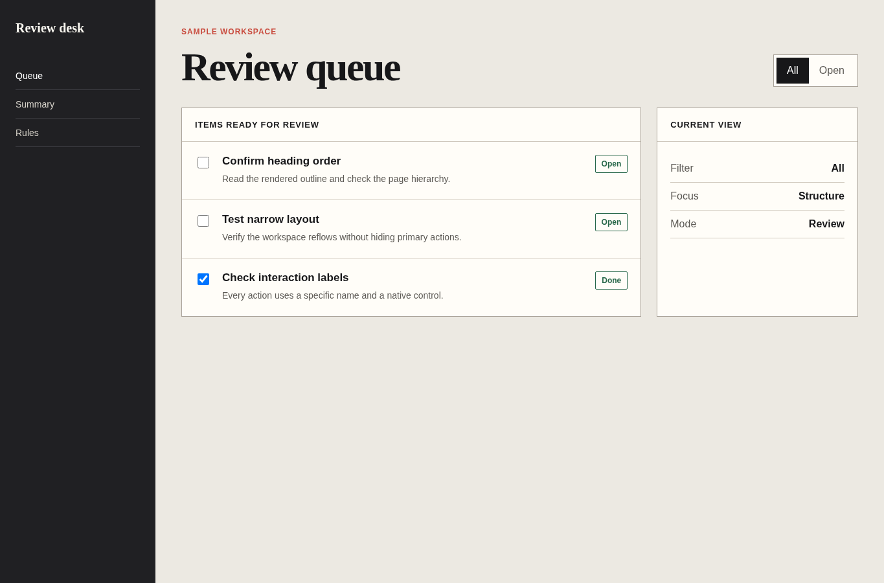

# Interface craft

Agent instruction: [`skills/interface-craft/SKILL.md`](../../skills/interface-craft/SKILL.md)

## Purpose

Build task-focused interfaces with semantic controls, explicit state, and coherent interaction feedback.

## Route here when

Use for forms, navigation, dashboards, filters, dialogs, settings, empty states, and task flows.

## Do not route here when

Do not use for visual direction alone or for browser acceptance after implementation is complete.

## What this skill owns

Component behavior, information hierarchy, control semantics, interaction states, disclosure, feedback, and implementation simplicity.

## Procedure

1. Name the user task and the success condition before choosing components.
2. Map default, hover, focus, active, loading, empty, error, success, and disabled states that actually apply.
3. Choose native elements first and define keyboard behavior for custom interactions.
4. Build the smallest coherent flow and keep the primary action visible at the right moment.
5. Verify the rendered path and remove controls that do not perform a real action.

## Evidence of completion

Working task paths, state coverage, semantic markup, visible focus, and browser evidence for primary interactions.

## Pairing

Pair with responsive-mobile for reflow; accessibility for semantics and keyboard review.

## Rendered examples

These images are screenshots from the browser-rendered demo pages in this repository.

A working queue, filter, and task state in one clear hierarchy.

A short completion path with specific labels and one primary action.

## Human documentation boundary

This guide and its images are for people. The router does not load them automatically. Agent context uses only the selected `SKILL.md` files for the current phase.
