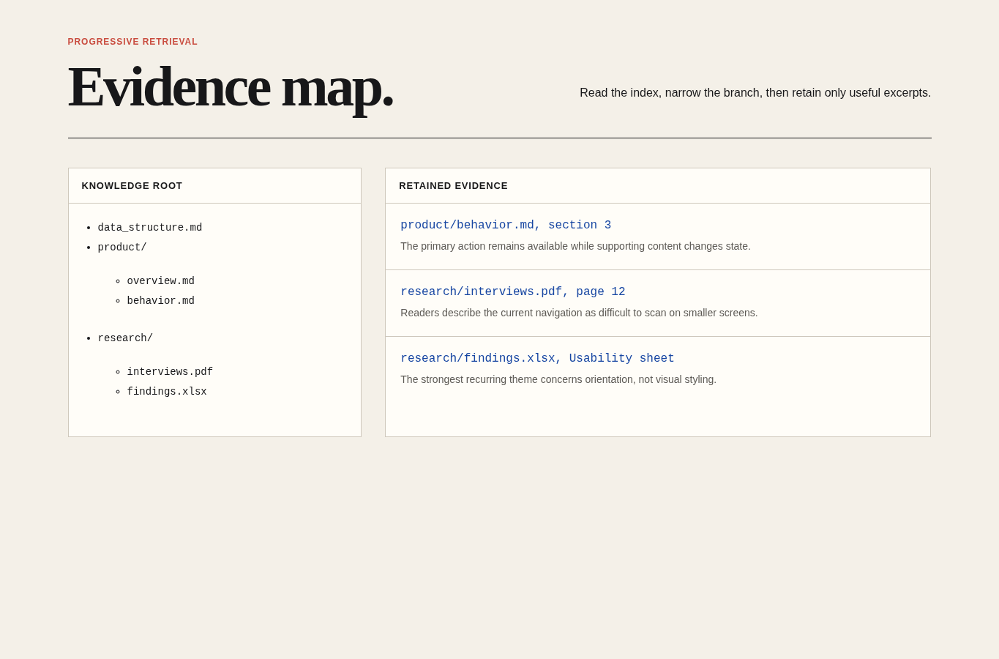
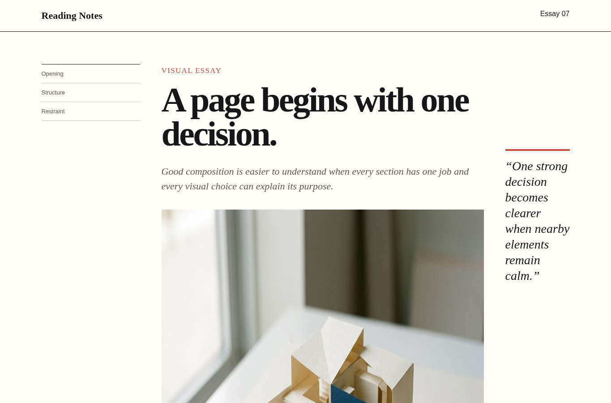

# Knowledge retrieval

Agent instruction: [`skills/knowledge-retrieval/SKILL.md`](../../skills/knowledge-retrieval/SKILL.md)

## Purpose

Navigate structured local material progressively and retain only relevant, attributable evidence.

## Route here when

Use for document corpora, product fact extraction, local research synthesis, spreadsheet evidence, or grounded downstream content.

## Do not route here when

Do not preload an entire corpus when an index, branch, or targeted excerpt can answer the question.

## What this skill owns

Scope, index reading, branch selection, excerpt retention, provenance, unknowns, and separation of evidence from synthesis.

## Procedure

1. Restate the question and the evidence needed to answer it.
2. Read the corpus index or structure description before opening documents.
3. Choose the smallest relevant branch and inspect summaries or headings first.
4. Extract only useful passages with file, section, page, or sheet references.
5. Write the answer with direct evidence, synthesis, and unknowns clearly separated.

## Evidence of completion

A scoped evidence map with stable source locations, retained excerpts, synthesis notes, and unresolved questions.

## Pairing

Pair with product-copy for grounded language; editorial-article for long-form synthesis.

## Rendered examples

These images are screenshots from the browser-rendered demo pages in this repository.

A file tree narrows retrieval and each retained excerpt keeps a location.

Selected evidence can support a focused artifact without loading the full corpus.

## Human documentation boundary

This guide and its images are for people. The router does not load them automatically. Agent context uses only the selected `SKILL.md` files for the current phase.
