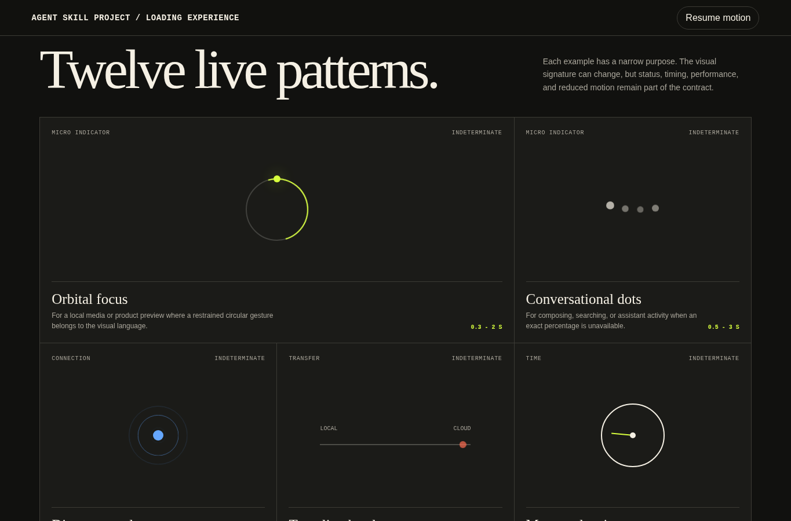
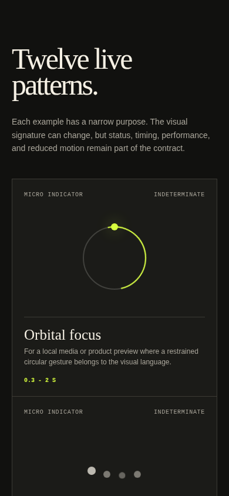

# Loading Experience

Loading Experience defines how to acknowledge real waiting without adding generic decoration or delaying ready content. It covers local indicators, skeletons, real progress, staged work, contextual task icons, recovery, reduced motion, and browser verification.

[Open the browser-rendered loading library](../examples/loading-experience.html)





## Reference study

The [supplied motion reference](https://pin.it/4glDIvR6m) is a short looping sheet of small monochrome loaders. It organizes examples into seven visual categories:

1. circles;
2. dots;
3. fading circles;
4. balls;
5. time;
6. signal strength;
7. task icons such as search, mail, gallery, home, download, delivery, and reading.

The useful lesson is not the quantity of spinners. It is that a small geometric motion can be varied by task, rhythm, direction, and icon meaning. The documentation translates those visual categories into product patterns with explicit timing, semantics, performance, and reduced-motion rules.

## Loading decision template

```text
Task:
Scope: page, region, control, or background
Blocking or non-blocking:
Expected duration:
Maximum duration:
Progress model: none, staged, or determinate
Context retained:
Result geometry known:
Status text:
Timeout:
Retry:
Cancel or background continuation:
Error state:
Motion signature:
Reduced-motion state:
```

Do not draw the loader until these fields are understood.

## Timing model

| Expected duration | Recommended response |
| --- | --- |
| Under 100 milliseconds | Show no loading UI. Apply the result immediately. |
| 100 milliseconds to 1 second | Use a local pending state, subtle indicator, or preserved button label. |
| 1 to 10 seconds | Use a skeleton, staged status, or real measured progress. |
| Over 10 seconds | Set expectations and provide cancel, retry, background continuation, or another recovery path. |

A small delay before showing an indeterminate indicator can prevent a flash on fast responses. This delay must never become a forced minimum display time. If content resolves first, show it immediately.

## Pattern library

The rendered library contains twelve live patterns.

| Pattern | Product meaning | Progress model |
| --- | --- | --- |
| Orbital focus | compact media or product processing | indeterminate |
| Conversational dots | composing or searching | indeterminate |
| Discovery pulse | proximity, location, or device discovery | indeterminate |
| Traveling bead | directional transfer | indeterminate |
| Measured wait | refresh or polling with a known window | indeterminate with expectation |
| Signal ladder | connection negotiation | stateful |
| Route handoff | export, fulfillment, or delivery | staged |
| Indexing pages | document parsing or reading preparation | indeterminate or staged |
| Wordmark wake | genuinely blocking application startup | entry only |
| Measured line | upload, export, installation, or batch work | determinate |
| Editorial tiles | collection results arriving in groups | staged |
| Structural skeleton | content with known final geometry | progressive |

The patterns deliberately use different visual signatures while sharing the same quality contract.

## Progress truth

### Indeterminate

Use indeterminate feedback only when the application cannot estimate completion. Keep it local and pair it with specific status language.

```text
Searching saved reports
Reconnecting to the studio speaker
Preparing a secure preview
```

Do not leave it running forever. Move to a timeout, error, or recovery state when the expected maximum duration is exceeded.

### Staged

Use stages when the task has meaningful phases but no reliable percentage.

```text
Preparing files
Compressing archive
Verifying package
Ready to download
```

Announce meaningful changes, not decorative micro-steps. A staged loader can preserve completed stage markers so the visitor understands where time was spent.

### Determinate

Use determinate progress only when the application has real values. Keep visual width, visible percentage, and semantic attributes synchronized.

```html
<div
  role="progressbar"
  aria-label="Uploading files"
  aria-valuemin="0"
  aria-valuemax="100"
  aria-valuenow="62">
</div>
```

Do not animate a fake percentage to 99 percent and wait.

## Status language

Good status text names real work and, when useful, its current amount:

- `Searching 148 saved reports`
- `Uploading 3 of 8 files`
- `Preparing the print-ready archive`
- `Indexing chapter 4 of 12`
- `Reconnecting to the studio speaker`

Avoid `Loading`, `Working on magic`, `Almost there`, and `Please be patient`. Those phrases do not help the visitor understand scope, progress, or recovery.

## Preserve context

A loading state should change only the smallest necessary region.

- Keep navigation and previous content visible when safe.
- Preserve filters, form values, and selection.
- Keep button text visible unless the replacement is equally specific.
- Reserve the final content geometry to prevent layout shift.
- Replace skeleton pieces as real content arrives.
- Do not cover the viewport for a local request.
- Do not remove a usable page while background work continues.

## Motion direction

Specify motion as a system:

```text
Geometry:
Energy:
Direction:
Cycle duration:
Easing:
Color roles:
Completion transition:
Static reduced-motion state:
```

Prefer `transform` and `opacity`. Animate a small region and use one primary rhythm. A product should not spin, bounce, shimmer, pulse, and scale in the same loading state.

The demo page uses:

- circular rotation for orbital focus;
- vertical transform and opacity for sequenced dots;
- scale and opacity for discovery pulses;
- rotation for a time sweep and turning page;
- scale for the signal ladder and measured progress;
- translate transforms for task handoffs, tiles, and shimmer;
- color and transform for the wordmark wake.

## Reduced motion

Under `prefers-reduced-motion: reduce`:

- continuous rotation, bounce, pulse, page-turn, and shimmer finish as a short or static state;
- the determinate value remains visible;
- status language remains unchanged;
- layout and recovery behavior remain identical;
- no indicator becomes an unexplained empty region.

The demo also includes a visible pause control so reviewers can inspect static states. A normal product loading state should end with the task and should not depend on the visitor to stop it.

## Accessibility

Use one concise live status for routine asynchronous work:

```html
<p role="status" aria-live="polite">Searching saved reports</p>
```

Keep decorative geometry hidden from assistive technology when visible status text carries the same meaning. Do not announce every animation frame or percentage tick. Preserve focus during normal progress and move it only when completion or error recovery requires a new action.

Retry and cancel controls must use action labels such as `Retry upload` or `Cancel export`, not `OK`.

## Recovery

For long or failure-prone work, define:

- an expected maximum duration;
- a timeout message;
- retry behavior;
- cancel behavior when safe;
- preserved user input;
- background continuation when supported;
- a final completion state.

Example:

```text
Expected: 4 to 12 seconds
Timeout: 20 seconds
Status: Preparing 8 selected files
Timeout copy: The archive could not be prepared within 20 seconds.
Actions: Retry archive, keep working
Preserved state: selected files and export settings
```

## Browser example

The loading library demonstrates:

- twelve live patterns across micro, connection, transfer, task, brand, progress, collection, and content categories;
- a working motion pause and resume control;
- a replayable determinate progress example;
- a semantic progress bar with an accessible name and current value;
- CSS-only motion except for control state;
- transform- and opacity-led animation;
- a reduced-motion stylesheet;
- deliberate mobile reflow with no horizontal overflow;
- no external scripts, images, styles, or fonts.

## Review checklist

- Does the feedback correspond to real work?
- Is it attached to the correct page region or control?
- Is the progress model truthful?
- Does visible text name the active task?
- Is ready content shown immediately?
- Does final geometry remain stable?
- Does animation stop on completion?
- Is the reduced-motion state still informative?
- Are timeout, error, retry, cancel, and preserved input defined where relevant?
- Does the semantic progress value match the visible state?
- Does the pattern remain legible near 400 CSS pixels?
- Is the animation light enough to avoid layout thrashing?

Agent instructions: [`skills/loading-experience/SKILL.md`](../../skills/loading-experience/SKILL.md).
