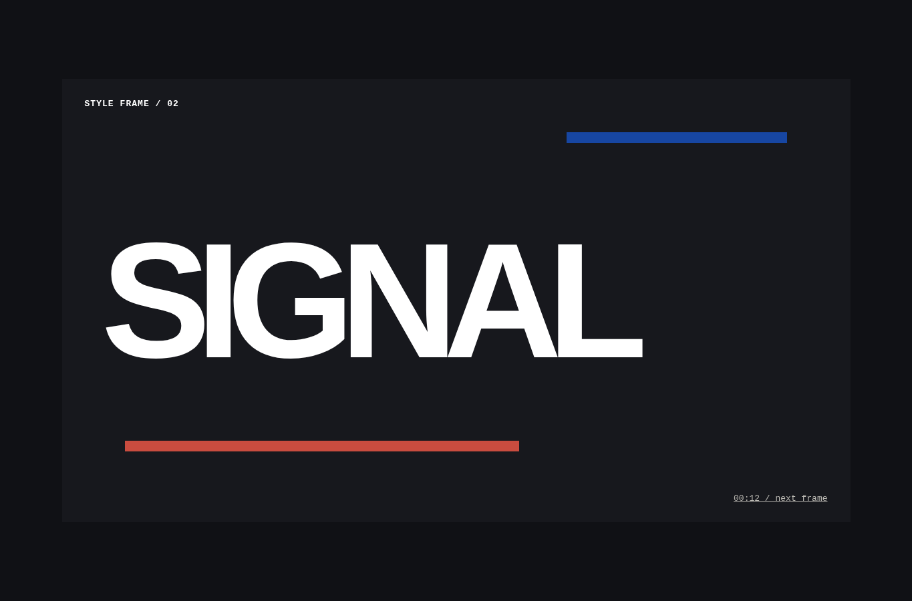
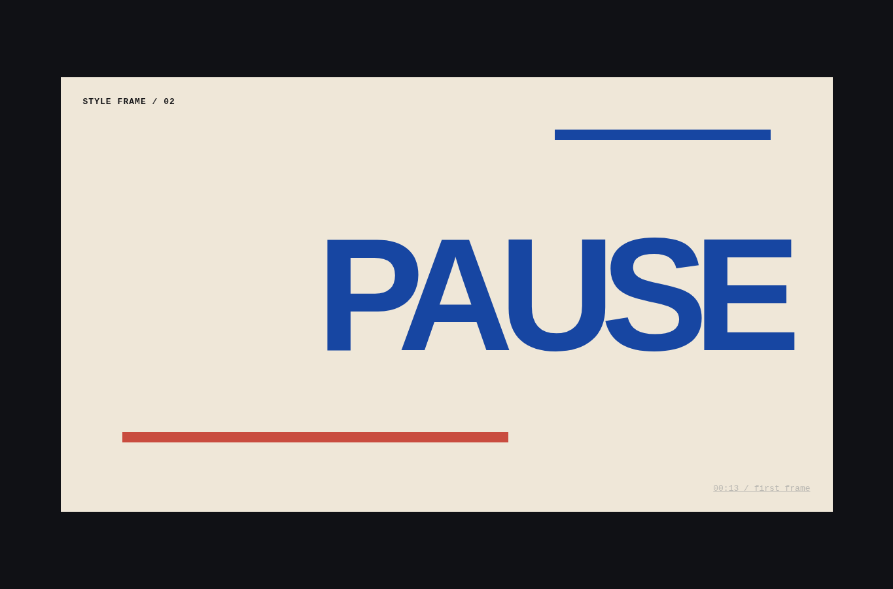

# Motion showreel

Agent instruction: [`skills/motion-showreel/SKILL.md`](../../skills/motion-showreel/SKILL.md)

## Purpose

Plan short visual sequences through beats, timing, typography, framing, transitions, audio assumptions, and export constraints.

## Route here when

Use for title sequences, launch reels, product motion studies, animated case-study moments, or concise brand films.

## Do not route here when

Do not add motion when a static explanation is clearer or when reduced-motion behavior cannot be supported.

## What this skill owns

Beat sheet, style frames, timing, transition logic, motion hierarchy, reduced-motion path, technical delivery, and export review.

## Procedure

1. Define duration, audience, message, output format, and viewing context.
2. Write a beat sheet with the purpose and duration of each moment.
3. Create style frames that prove composition, type, color, and image treatment.
4. Choose a small motion vocabulary and assign movement to narrative change.
5. Review pacing, legibility, reduced-motion behavior, loop or ending, and export quality.

## Evidence of completion

A beat sheet, approved style frames, timing plan, motion rules, reduced-motion alternative, and export checklist.

## Pairing

Pair with design-direction for visual thesis; web-presentation when motion belongs inside a slide narrative.

## Rendered examples

These images are screenshots from the browser-rendered demo pages in this repository.

The first beat establishes energy through scale, contrast, and direction.

The second beat changes pace while preserving the same visual language.

## Human documentation boundary

This guide and its images are for people. The router does not load them automatically. Agent context uses only the selected `SKILL.md` files for the current phase.
