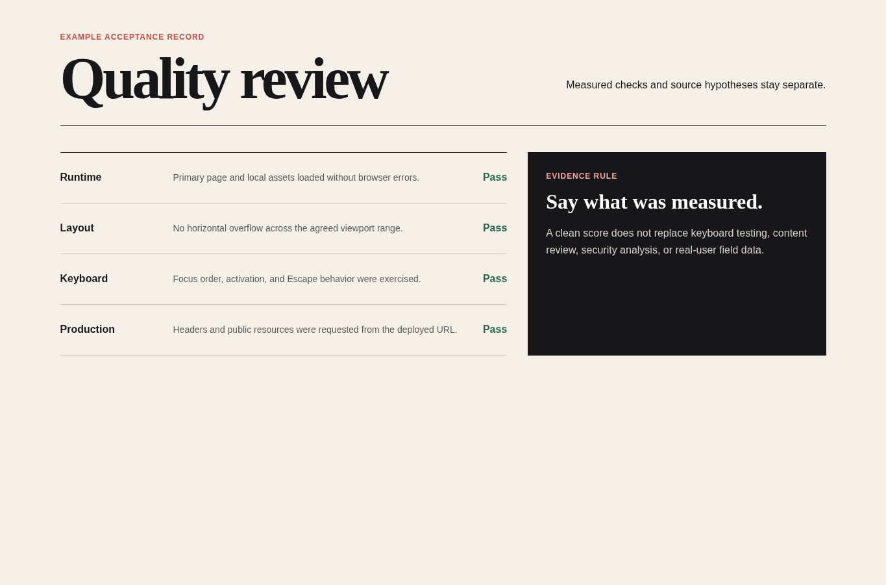
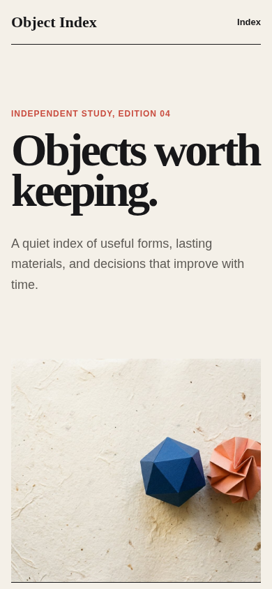

# Performance

Agent instruction: [`skills/performance/SKILL.md`](../../skills/performance/SKILL.md)

## Purpose

Measure user-visible performance, trace likely causes, make bounded changes, and verify under comparable conditions.

## Route here when

Use for slow rendering, interaction delay, layout shift, media cost, bundle growth, excessive runtime work, or a performance regression.

## Do not route here when

Do not optimize from intuition alone and do not present lab observations as field data.

## What this skill owns

Baseline conditions, measurement evidence, hypotheses, budget decisions, implementation changes, and verification.

## Procedure

1. Define the route, device class, network and CPU conditions, cache state, and run count.
2. Capture a baseline and retain the evidence before changing code.
3. Map the strongest findings to network, main-thread, rendering, media, or third-party causes.
4. Apply the smallest change likely to affect the measured problem.
5. Repeat the same measurement and report improvement, regression, variance, and limits.

## Evidence of completion

Comparable before-and-after results, traceable hypotheses, implementation diff, and a clear distinction between lab and field evidence.

## Pairing

Pair with asset-image for media; browser-acceptance for user path confirmation.

## Rendered examples

These images are screenshots from the browser-rendered demo pages in this repository.

The record says what was checked and avoids claiming more than the evidence supports.

One purposeful image keeps the mobile composition strong without asset excess.

## Human documentation boundary

This guide and its images are for people. The router does not load them automatically. Agent context uses only the selected `SKILL.md` files for the current phase.
