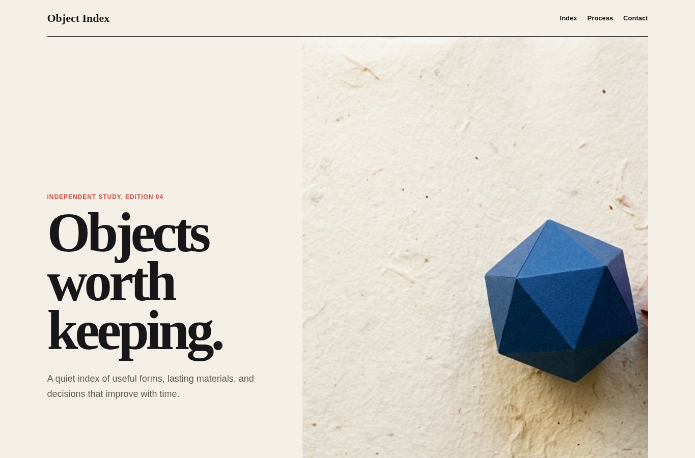
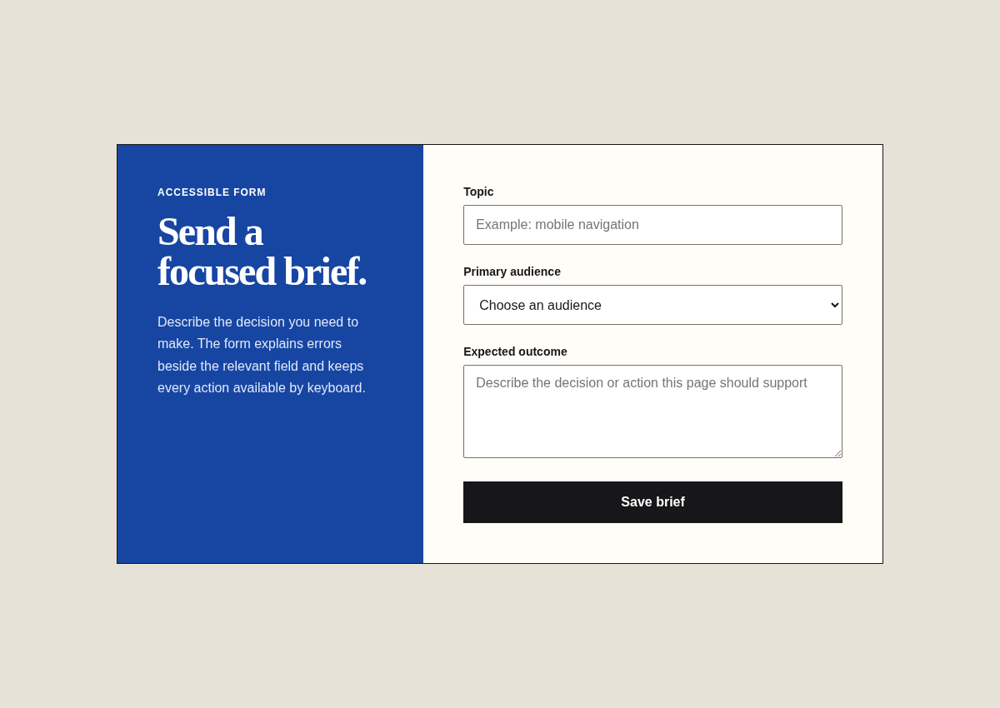

# Product copy

Agent instruction: [`skills/product-copy/SKILL.md`](../../skills/product-copy/SKILL.md)

## Purpose

Write clear interface and page language from user intent, product truth, and available evidence.

## Route here when

Use for headlines, instructions, labels, errors, onboarding, calls to action, empty states, and concise product explanations.

## Do not route here when

Do not invent customer proof, performance claims, scarcity, outcomes, or product facts that were not provided.

## What this skill owns

Message hierarchy, voice, labels, state copy, errors, calls to action, evidence use, and open content questions.

## Procedure

1. Identify the audience, situation, desired action, and facts the page can support.
2. Write the message hierarchy before polishing individual lines.
3. Prefer specific nouns and verbs over generic value language.
4. Draft state copy in context, including empty, error, success, and permission states.
5. Read the rendered page, remove repetition, and flag missing facts instead of filling gaps.

## Evidence of completion

A copy map tied to UI states, a list of supported claims, and explicit questions for information that remains unknown.

## Pairing

Pair with interface-craft for state placement; knowledge-retrieval when product facts live in a corpus.

## Rendered examples

These images are screenshots from the browser-rendered demo pages in this repository.

A specific premise controls the headline, support line, and section language.

Each label asks for a concrete input and the action names its result.

## Human documentation boundary

This guide and its images are for people. The router does not load them automatically. Agent context uses only the selected `SKILL.md` files for the current phase.
