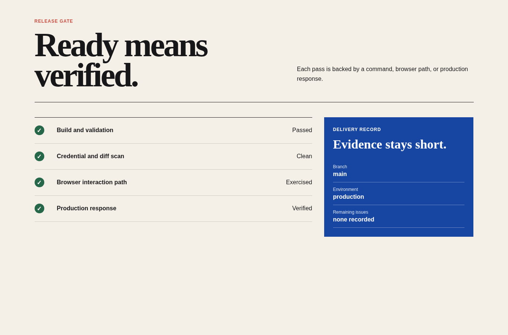

# Release and delivery

Agent instruction: [`skills/release-delivery/SKILL.md`](../../skills/release-delivery/SKILL.md)

## Purpose

Move verified work into production while protecting repository hygiene, credentials, deployment configuration, rollback awareness, and handoff clarity.

## Route here when

Use for commits, repository setup, continuous validation, deployment, public launch, or operational handoff.

## Do not route here when

Do not release known critical failures or assume a successful build proves the deployed site works.

## What this skill owns

Diff review, ignore rules, credential scan, validation, commit and push, deployment configuration, smoke test, rollback note, and delivery record.

## Procedure

1. Review the diff, tracked files, ignore rules, generated artifacts, and repository status.
2. Run validation and scan for credentials or unintended private material.
3. Create a focused commit and push only the intended branch and files.
4. Deploy through the approved path and retain the resulting public URL and revision.
5. Smoke test the production page, resources, interactions, and headers before handoff.

## Evidence of completion

Clean repository state, validation output, commit and revision, deployment URL, production smoke results, and remaining issues.

## Pairing

Pair with browser-acceptance before and after deploy; seo-security for public posture.

## Rendered examples

These images are screenshots from the browser-rendered demo pages in this repository.

Build, credential, browser, and production conditions are recorded in one place.

The release consumes verified evidence instead of replacing it with a summary claim.

## Human documentation boundary

This guide and its images are for people. The router does not load them automatically. Agent context uses only the selected `SKILL.md` files for the current phase.
