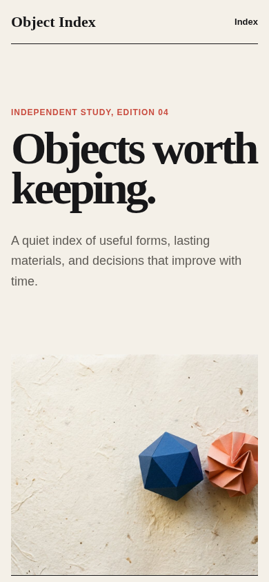
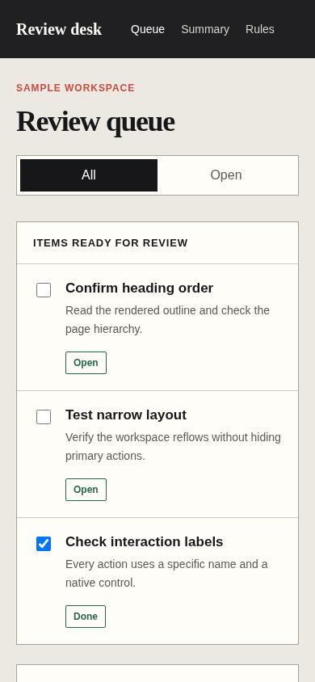

# Responsive mobile

Agent instruction: [`skills/responsive-mobile/SKILL.md`](../../skills/responsive-mobile/SKILL.md)

## Purpose

Make narrow layouts deliberate, readable, reachable, and free from accidental horizontal overflow.

## Route here when

Use when a page must adapt across viewports or when mobile navigation, dense data, or action reachability is at risk.

## Do not route here when

Do not route it only to shrink typography after a desktop composition is finished.

## What this skill owns

Reflow order, breakpoints, touch targets, reading measure, navigation behavior, media crop, overflow, and mobile action placement.

## Procedure

1. Start near 400 CSS pixels and identify the first task and reading order.
2. Choose which regions stack, scroll intentionally, simplify, or remain fixed.
3. Set fluid type and spacing with bounded minimum and maximum values.
4. Check long labels, zoom, virtual keyboard effects, and safe touch target sizes.
5. Inspect representative narrow, middle, and wide viewports in a real browser.

## Evidence of completion

Screenshots and measurements across agreed viewports, no accidental overflow, and verified access to every primary action.

## Pairing

Pair with interface-craft for behavior; accessibility for zoom, focus, and target review.

## Rendered examples

These images are screenshots from the browser-rendered demo pages in this repository.

Large editorial type reflows without losing the opening hierarchy.

Dense task rows remain readable and reachable on a narrow screen.

## Human documentation boundary

This guide and its images are for people. The router does not load them automatically. Agent context uses only the selected `SKILL.md` files for the current phase.
