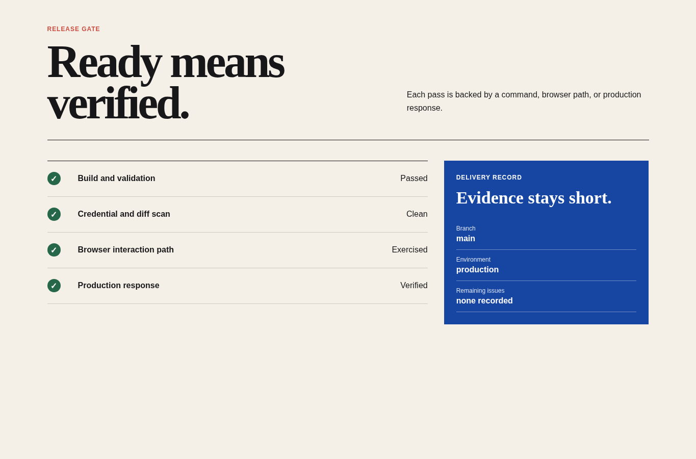

# SEO and security

Agent instruction: [`skills/seo-security/SKILL.md`](../../skills/seo-security/SKILL.md)

## Purpose

Review public discovery and defensive posture with separate evidence for metadata, crawl behavior, sensitive data, dependencies, input boundaries, and deployed headers.

## Route here when

Use before public release, after routing or metadata changes, when handling user input, or when dependencies and deployment configuration change.

## Do not route here when

Do not describe a limited scan as a complete security assessment or guaranteed ranking result.

## What this skill owns

Titles and descriptions, canonical and index behavior, structured content, public resource exposure, secrets, dependency risk, input handling, headers, and abuse boundaries.

## Procedure

1. Confirm public routes, intended index behavior, titles, descriptions, headings, and canonical targets.
2. Inspect rendered markup and production responses rather than source alone.
3. Scan tracked files and diffs for credentials, sensitive values, and unintended public data.
4. Review user-controlled input, dependency changes, external resources, headers, and abuse paths.
5. Rank findings by impact and state the scope and limits of the review.

## Evidence of completion

Route-level metadata checks, secret scan results, production header evidence, risk-ranked findings, and explicit scope limits.

## Pairing

Pair with release-delivery for production checks; browser-acceptance for rendered verification.

## Rendered examples

These images are screenshots from the browser-rendered demo pages in this repository.

Discovery and defensive checks remain evidence-based and route-specific.

Credential scanning and production responses are release conditions, not afterthoughts.

## Human documentation boundary

This guide and its images are for people. The router does not load them automatically. Agent context uses only the selected `SKILL.md` files for the current phase.
