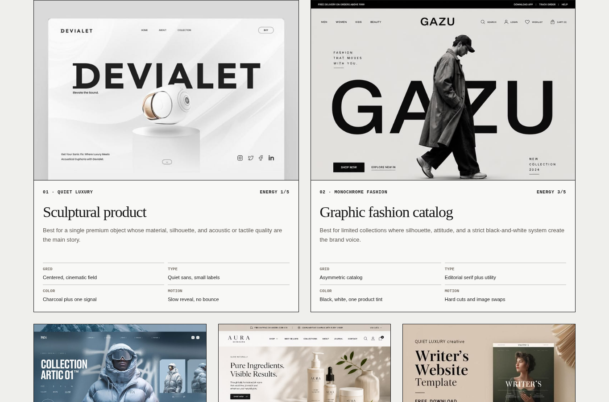
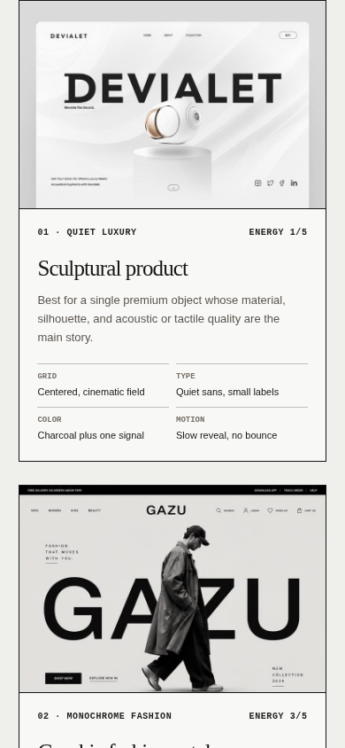

# Style Atlas

The Style Atlas prevents one familiar aesthetic from becoming the answer to every website. It turns visual references into a bounded selection process based on product, audience, content, identity source, and intended energy.

[Open the browser-rendered atlas](../examples/style-atlas.html)





## What the atlas contains

The atlas organizes twenty supplied references into four families. Each reference is treated as a study of relationships rather than a template to copy.

| Family | Directions | Useful for |
| --- | --- | --- |
| Restrained product systems | sculptural product, monochrome fashion, arctic catalog, botanical skincare, quiet writer | premium products, catalogs, care products, authors |
| Organic editorial commerce | eco corporate, coffee commerce, warm coffee, soft proposal, warm author | sustainable services, food, hospitality, consultancies, personal publications |
| Character-led editorial | monochrome dossier, blue archive, orange modular, soft dashboard, cinematic dossier | profiles, stories, entertainment, games, creator communities |
| Playful personal and system | illustrated travel, early web, scrapbook social, neo-brutal system, pastel profile | discovery tools, personal archives, communities, experimental products |

The source images remain visible in the browser atlas so people can inspect composition, hierarchy, density, crop, and color in context. The written recipes identify transferable decisions beside each image.

## Decision template

Complete this before selecting a style:

```text
Product or service:
Primary audience:
Primary action:
Content geometry:
Content density:
Identity source:
Energy from 1 to 5:
Trust posture:
Available assets:
Motion tolerance:
Mobile and accessibility constraints:
```

Content geometry is especially important:

- **Story** favors editorial pacing and intentional reading sequence.
- **Catalog** needs repeatable comparison and product hierarchy.
- **Task** needs state clarity and interaction efficiency.
- **Profile** needs a strong identity source and selective detail.
- **Archive** needs navigation, grouping, and discovery.
- **Community** needs authored personality without sacrificing repeated content.

## Choose by fit, not preference

Score a candidate from 0 to 2 for each category:

| Category | 0 | 1 | 2 |
| --- | --- | --- | --- |
| Product fit | contradicts the product | workable with changes | naturally supports it |
| Primary action | obscures the action | action can be repaired | hierarchy reinforces it |
| Audience | breaks expected trust | acceptable | matches expectation and fluency |
| Content geometry | fights the content | partial fit | structure fits directly |
| Asset feasibility | required assets are missing | substitutes are possible | suitable assets exist |
| Identity authenticity | feels borrowed | partly ownable | can become distinctly original |
| Mobile resilience | collapses at narrow width | needs major simplification | reflows clearly |
| Accessibility | depends on inaccessible choices | repairable | resilient by default |
| Performance | likely too costly | manageable | naturally lightweight |
| Maintenance | fragile | manageable | repeatable and scalable |

Reject any direction that scores zero on a non-negotiable requirement. A visually exciting option is not valid if it requires unavailable character art, unreadable typography, or a dense collage that cannot survive mobile.

## Reference map

### Restrained product systems

- **Sculptural product** uses one object, a cinematic field, quiet utility type, and restrained movement.
- **Graphic fashion catalog** uses monochrome contrast, silhouette, asymmetry, and hard image changes.
- **Arctic technical catalog** combines environmental mood with specification bands and safety accents.
- **Clinical botanical** balances ingredient warmth, evidence, routine, and commerce.
- **Literary restraint** lets language, rhythm, and a small number of personal details carry authority.

### Organic editorial commerce

- **Botanical authority** supports credible corporate content with natural photography and strong typography.
- **Joyful roastery** turns packaging, origin, and ritual into an energetic purchase path.
- **Slow ritual** gives hospitality and origin stories calm pacing before a booking or purchase.
- **Reflective service** frames process and collaboration with soft fields and layered sections.
- **Personal publication** combines biography, portraiture, and published thinking.

### Character-led editorial

- **Monochrome character study** uses portrait, quote, and visual silence for a focused dossier.
- **Cool character archive** balances a dominant hero with facts, scenes, and modular navigation.
- **Athletic chapter system** uses energetic crops, statistics, numbering, and compressed type.
- **Friendly world hub** combines mascot or creator identity with a practical dashboard of content.
- **Dark narrative dossier** builds tension through masked imagery, case-note structure, and one sharp accent.

### Playful personal and system

- **Destination discovery map** pairs illustrated geography with search, recommendation, and route controls.
- **Desktop memory box** treats windows, icons, and discovery as the content experience.
- **Scrapbook network** uses doodles, notes, photos, and imperfect frames to communicate authorship.
- **Conspicuous operations** turns hard borders, loud states, and direct controls into the product language.
- **Handmade life page** supports casual stories and snapshots with paper, handwriting, and loose placement.

## From reference to original direction

For every reference, separate four layers:

1. **Structure**: content order, section rhythm, grid, and responsive behavior.
2. **Hierarchy**: type scale, image dominance, control weight, and whitespace.
3. **Atmosphere**: color temperature, texture, crop, and motion posture.
4. **Identity**: characters, logos, product forms, slogans, and distinctive assets.

The first three layers can inform a new direction. The identity layer must be replaced by owned or licensed product material.

A good translation might keep a reference's relationship of oversized type, small annotations, and a narrow accent color while changing the grid, subject, copy, palette values, and interaction model for the actual product.

## Mixing rules

Use one foundation and, only when the product requires it, one secondary influence applied to a single dial.

```text
Foundation: Arctic technical catalog
Secondary influence: the warmer reading type of personal publication
Reason: the product has technical specifications and long field notes
Boundary: grid, color posture, icon system, and motion remain arctic and technical
```

Do not combine two full foundations. Avoid stacks such as scrapbook type, luxury spacing, brutalist borders, anime crops, and corporate motion on one page.

## Implementation direction

A selected style must end in explicit build rules:

```text
Composition:
Display type:
Reading type:
Utility type:
Field and surface color roles:
Accent proportion:
Density:
Border, radius, and shadow system:
Image subject and crop:
Decorative asset language:
Motion purpose and duration:
Reduced-motion state:
Mobile reading order:
Narrow-screen simplification:
```

Replace weak words such as `clean`, `modern`, `premium`, or `bold` with visible decisions. For example, `premium` might become `one centered product object, charcoal field, 70 percent negative space, 14 pixel utility labels, no shadow, and one 800 millisecond opacity reveal`.

## Browser example

The rendered atlas demonstrates:

- exactly twenty supplied references;
- four clearly separated families;
- a five-dial decision compass;
- a recipe beside every reference;
- a final implementation brief;
- a deliberate mobile reflow near 400 CSS pixels;
- local images with meaningful alternative text;
- no dependency on external scripts, styles, images, or fonts.

The page is intentionally a curated catalog rather than a random mood-board grid. Its shell stays consistent while each family receives a distinct color field, allowing comparison without turning the documentation itself into a mixture of unrelated themes.

## Review checklist

- Is the selection justified by product and audience rather than trend?
- Does the content geometry fit the chosen family?
- Can available assets support the direction?
- Is there one foundation, not several competing styles?
- Are grid, type, color, density, image, and motion rules explicit?
- Does the direction remain clear at approximately 400 CSS pixels?
- Are character, brand, copy, and distinctive identity elements replaced?
- Are reduced motion, accessibility, and performance part of the direction?
- Are rejected alternatives and tradeoffs recorded?

Agent instructions: [`skills/style-atlas/SKILL.md`](../../skills/style-atlas/SKILL.md).
