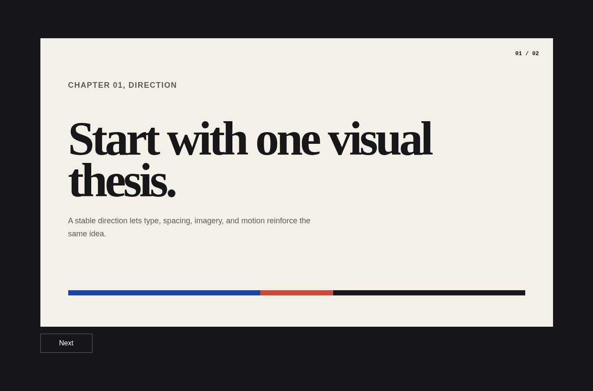
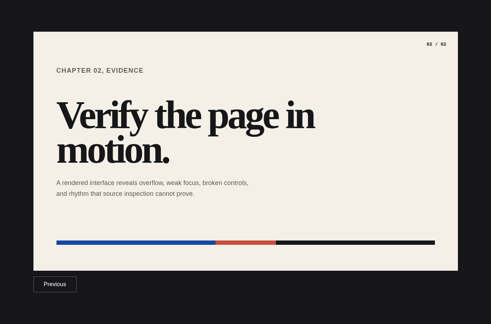

# Web presentation

Agent instruction: [`skills/web-presentation/SKILL.md`](../../skills/web-presentation/SKILL.md)

## Purpose

Build slide-like narratives as stable web stages with deliberate sequencing, legible type, working controls, and bounded motion.

## Route here when

Use for talks, teaching sequences, product narratives, interactive decks, or kiosk presentations.

## Do not route here when

Do not use it for continuous long-form reading or a dashboard with persistent controls.

## What this skill owns

Story arc, slide purpose, stage geometry, type scale, navigation, routeable state, media behavior, keyboard input, and aspect-ratio testing.

## Procedure

1. Write the audience, time limit, conclusion, and one sentence per slide.
2. Arrange slides so every frame advances the argument rather than restating it.
3. Set a stable stage, safe margins, type hierarchy, and media rules.
4. Implement visible controls, keyboard navigation, and routeable slide state.
5. Test common aspect ratios, narrow screens, overflow, and reduced motion.

## Evidence of completion

A slide outline, stable routes, working controls, aspect-ratio screenshots, and an interaction acceptance record.

## Pairing

Pair with design-direction for visual grammar; motion-showreel for a short animated sequence.

## Rendered examples

These images are screenshots from the browser-rendered demo pages in this repository.

One idea, stable margins, and a restrained visual grammar introduce the sequence.

The next frame changes the argument while preserving the stage system.

## Human documentation boundary

This guide and its images are for people. The router does not load them automatically. Agent context uses only the selected `SKILL.md` files for the current phase.
